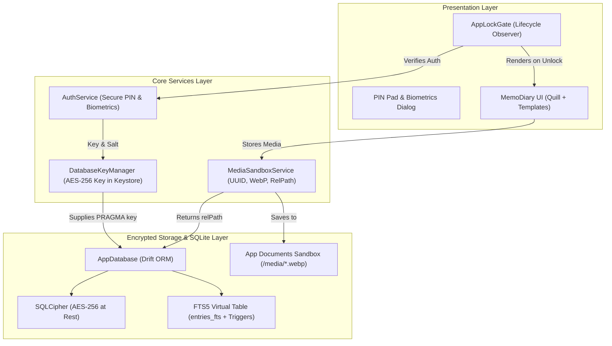

# Implementation Plan — Phase 0: Architecture, Encrypted Database & Sandbox Foundation

MemoDiary (拾光日记) is an offline-first, privacy-focused multimodal diary and weekly review application for Android (10+) and iOS (15+) with **zero backend**, **$0 build & runtime cost**, and **strict privacy encryption at rest**.

This plan outlines the architecture, database layer, sandboxed media pipeline, app security gate, and test suite for **Phase 0**.

---

## User Review Required

> [!IMPORTANT]
> **1. SQLCipher Encryption Key Management Strategy**
> Database encryption at rest requires a 256-bit AES passphrase. We will generate a cryptographically secure random key on first launch via `Random.secure()`, store it securely in device hardware keystore/keychain via `flutter_secure_storage`, and retrieve it automatically to unlock `sqlcipher_flutter_libs`. For headless unit tests, `AppDatabase.forTesting()` will use in-memory `NativeDatabase.memory()` to ensure fast, deterministic tests without native channel dependencies.

> [!IMPORTANT]
> **2. FTS5 Indexing & Real-Time Sync Triggers**
> SQLite FTS5 virtual tables (`entries_fts`) do not natively mirror standard table mutations without triggers or manual synchronization. We implement 3 automatic SQLite triggers (`AFTER INSERT`, `AFTER UPDATE`, `AFTER DELETE` on `entries`) directly in the migration script. This guarantees zero synchronization drift between Quill delta plain text and the search index.

> [!NOTE]
> **3. Media Compression Headless Fallback**
> `flutter_image_compress` uses platform channels (Android/iOS native image decoders). In unit test environments where native platform channels are unavailable, `MediaSandboxService` will use an injectable compressor adapter that gracefully copies the file while maintaining the exact UUID and relative path contracts (`media/{uuid}.webp`).

---

## Architecture Overview



---

## Proposed Changes

Grouped by component layer:

### 1. Dependencies & Configuration (`pubspec.yaml`)

Verify and configure all 100% free open-source packages in `pubspec.yaml`:
- **Database & Encryption**: `drift`, `drift_flutter`, `sqlcipher_flutter_libs`, `sqlite3`
- **Security & Auth**: `flutter_secure_storage`, `local_auth`, `crypto`
- **Media & Files**: `path_provider`, `path`, `uuid`, `flutter_image_compress`, `permission_handler`
- **Dev & Generation**: `build_runner`, `drift_dev`, `flutter_lints`, `flutter_test`

#### [MODIFY] `pubspec.yaml`
- Ensure SDK constraints and dependencies are properly configured.
- Verify zero paid dependencies.

---

### 2. Encrypted Database Layer (`lib/core/database/`)

Implement the core schema invariant specified in `GEMINI.md` with all 5 tables and default seeded templates.

#### [NEW] `lib/core/database/tables/templates.dart`
- Definition of `Templates` table:
  - `id`: Text (Primary Key)
  - `name`: Text
  - `backgroundType`: Text (`color`, `paper_texture`, `grid`, `lined`)
  - `backgroundValue`: Text (hex `#FFFFFF` or asset/texture key)
  - `fontFamily`: Text (nullable)
  - `lineSpacing`: Real (default 1.5)
  - `marginHorizontal`: Real (default 16.0)
  - `isCustom`: Bool (default false)

#### [NEW] `lib/core/database/tables/notebooks.dart`
- Definition of `Notebooks` table:
  - `id`: Text (Primary Key)
  - `title`: Text (min 1, max 100)
  - `defaultTemplateId`: Text (Foreign Key -> `templates.id`)
  - `createdAt`: DateTime (default `currentDateAndTime`)

#### [NEW] `lib/core/database/tables/entries.dart`
- Definition of `Entries` table:
  - `id`: Text (Primary Key)
  - `notebookId`: Text (Foreign Key -> `notebooks.id`)
  - `templateId`: Text (Foreign Key -> `templates.id`)
  - `title`: Text (nullable)
  - `contentDelta`: Text (Quill Delta JSON)
  - `plainText`: Text (plain text extracted for FTS5)
  - `entryDate`: DateTime (epoch stored as DateTime)
  - `mood`: Integer (1-5, nullable)
  - `weather`: Text (nullable)
  - `isWeeklyReview`: Bool (default false)
  - `weekNumber`: Integer (nullable)
  - `unlockAt`: DateTime (epoch for Time Capsule, nullable)
  - `createdAt`: DateTime (default `currentDateAndTime`)
  - `updatedAt`: DateTime (default `currentDateAndTime`)
  - `isDeleted`: Bool (default false, 30-day trash bin flag)

#### [NEW] `lib/core/database/tables/media_attachments.dart`
- Definition of `MediaAttachments` table:
  - `id`: Text (Primary Key)
  - `entryId`: Text (Foreign Key -> `entries.id`)
  - `mediaType`: Text (`image`, `video`)
  - `relativePath`: Text (Sandboxed path: e.g. `media/{uuid}.webp`)
  - `thumbnailPath`: Text (nullable)
  - `ocrText`: Text (nullable)
  - `createdAt`: DateTime (default `currentDateAndTime`)

#### [NEW] `lib/core/database/database_key_manager.dart`
- Generates and manages the 256-bit AES encryption key using `flutter_secure_storage`.
- Key generation: 32 random secure bytes converted to a hex string.
- Seamlessly retrieves key on startup.

#### [NEW] `lib/core/database/app_database.dart`
- Drift database class `@DriftDatabase(...)`:
  - Registers tables: `Templates`, `Notebooks`, `Entries`, `MediaAttachments`.
  - Schema version: `1`.
  - `MigrationStrategy.onCreate`:
    1. Creates all Drift tables (`m.createAll()`).
    2. Creates FTS5 virtual table:
       ```sql
       CREATE VIRTUAL TABLE IF NOT EXISTS entries_fts USING fts5(
         id UNINDEXED,
         title,
         plain_text,
         tokenize='unicode61'
       );
       ```
    3. Creates sync triggers (`entries_ai`, `entries_au`, `entries_ad`).
    4. Seeds 4 default templates:
       - **Minimalist White** (`template_minimalist_white`): color, `#FFFFFF`, line_spacing 1.5, margin 20.0
       - **Lined Paper** (`template_lined_paper`): lined, `#FDFBF7`, line_spacing 1.8, margin 24.0
       - **Retro Kraft Scrapbook** (`template_retro_kraft`): paper_texture, `#EFE6D5`, line_spacing 1.6, margin 20.0
       - **Weekly Review** (`template_weekly_review`): grid, `#F4F5F7`, line_spacing 1.5, margin 16.0
    5. Seeds default notebook: `notebook_default` ("My Diary" / "我的日记").
  - Encrypted constructor:
    ```dart
    AppDatabase.encrypted({required File dbFile, required String encryptionKey})
    ```
    using `NativeDatabase.createInBackground` and `PRAGMA key = '$encryptionKey';`.
  - Testing constructor:
    ```dart
    AppDatabase.forTesting(QueryExecutor executor) : super(executor);
    ```
  - Query helpers:
    - `searchEntries(String query)`: queries `entries_fts` and joins with `entries`.

---

### 3. Media Sandbox Service (`lib/core/services/`)

Ensures sandboxed media isolation: strictly no absolute photo gallery paths in SQLite.

#### [NEW] `lib/core/services/media_sandbox_service.dart`
- Injected with application documents directory (or test directory).
- Methods:
  - `Future<String> copyAndCompressImage(File sourceFile)`:
    - Generates UUID `v4`.
    - Destination relative path: `media/{uuid}.webp`.
    - Creates `media/` directory in sandbox if missing.
    - Compresses source image via `flutter_image_compress` (format: `CompressFormat.webp`, `minWidth: 1600`, `minHeight: 1600`, `quality: 80`).
    - Fallback: file copy if compressor is not available (e.g. in headless unit tests).
    - Returns strictly relative path: `media/{uuid}.webp`.
  - `Future<File> getFileFromRelativePath(String relativePath)`:
    - Resolves sandboxed absolute file path: `join(appDocsDir.path, relativePath)`.
  - `Future<bool> deleteMedia(String relativePath)`:
    - Safely removes the sandboxed file from disk.
  - `bool isSandboxedPath(String path)`:
    - Validates that a path is relative and not an absolute gallery URI.

---

### 4. Security & App Lock Gate (`lib/features/auth/`)

Biometric authentication (`local_auth`) and local PIN verification on cold start and app resume.

#### [NEW] `lib/core/services/auth_service.dart`
- PIN management:
  - Salts and hashes PIN using SHA-256 (`crypto`).
  - Stores PIN hash and salt in `flutter_secure_storage`.
  - Verifies input PIN against stored hash.
- Biometrics management:
  - Interacts with `LocalAuthentication`.
  - Checks hardware support (`canCheckBiometrics`, `isDeviceSupported`).
  - Executes biometric prompt (`authenticate(localizedReason: ...)`).
- Settings toggles:
  - `isLockEnabled()`
  - `isBiometricEnabled()`

#### [NEW] `lib/features/auth/app_lock_gate.dart`
- Top-level gate widget wrapping the app's root navigation/home.
- Lifecycle management using `WidgetsBindingObserver`:
  - `initState`: checks cold start lock status.
  - `didChangeAppLifecycleState`: triggers lock when transitioning from background (`paused`/`inactive`) to foreground (`resumed`).
- Built-in Lock View:
  - Clean numeric PIN pad (1–9, 0, delete, biometric trigger).
  - PIN dot indicator (4 or 6 digits).
  - Smooth animation on invalid PIN attempt with error message.
  - Direct biometric trigger button (Fingerprint / Face ID).
  - Unlocks immediately upon successful PIN or biometric verification.

#### [MODIFY] `lib/main.dart`
- Initialize Flutter binding.
- Fix experimental dot-shorthand errors.
- Wrap app with `AppLockGate`.

---

### 5. Comprehensive Unit Test Suite (`test/`)

Verify schema creation, template seeding, FTS5 sync, relative path generation, and PIN hashing.

#### [NEW] `test/core/database/app_database_test.dart`
- Tests with `NativeDatabase.memory()`:
  - Verify all 5 tables are created.
  - Verify 4 default templates are seeded with correct IDs, types, and values.
  - Verify default notebook exists.
  - Test CRUD operations on `entries` and `media_attachments`.
  - Test FTS5 trigger synchronization: inserting an entry automatically creates an `entries_fts` record; updating updates `entries_fts`; deleting deletes `entries_fts`.
  - Test `searchEntries()` against FTS5.

#### [NEW] `test/core/services/media_sandbox_service_test.dart`
- Tests using a temporary scratch directory:
  - Verify relative path generation matches pattern `media/<uuid>.webp`.
  - Verify relative path resolution produces a valid file in the sandbox.
  - Verify sandbox isolation: path is strictly relative and contains no device gallery root paths.
  - Verify file deletion in sandbox.

#### [NEW] `test/core/services/auth_service_test.dart`
- Tests with mock secure storage:
  - Verify PIN hashing with salt.
  - Verify correct PIN returns `true` and incorrect PIN returns `false`.
  - Verify lock status enable/disable transitions.

---

## Verification Plan

### Automated Tests
Run unit tests across the entire test suite:
```bash
# 1. Run build_runner to generate Drift database code
flutter pub run build_runner build --delete-conflicting-outputs

# 2. Run static analysis
flutter analyze

# 3. Execute all unit tests
flutter test
```

### Acceptance Checks
1. **Schema Check**:
   - `templates`, `notebooks`, `entries`, `media_attachments`, and `entries_fts` tables exist in SQLite.
   - 4 default templates seeded with exact values.
2. **Sandbox Isolation Check**:
   - Media service never emits absolute paths for SQLite storage; always returns `media/{uuid}.webp`.
3. **FTS5 Synchronization Check**:
   - Entry insert/update/delete triggers automatically synchronize the virtual table `entries_fts`.
4. **Auth & Gate Check**:
   - Cold start and resume triggers lock state when enabled.
   - Valid PIN / biometric unlocks the gate.
5. **No Paid Dependencies**:
   - 100% of packages in `pubspec.yaml` are free, open-source (MIT/BSD/Apache).
