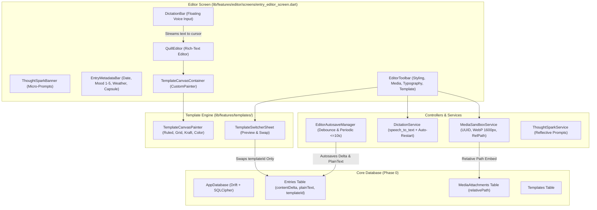

# Implementation Plan — Phase 1: Decoupled Template Engine & Multimodal Editor

In Phase 0, we established the encrypted SQLite database (`drift` + `sqlcipher_flutter_libs`), sandboxed media service (`MediaSandboxService`), and app security gate (`AppLockGate`).

In **Phase 1**, we implement the core journaling experience:
1. **Procedural Canvas Templates**: `CustomPainter` rendering backgrounds, ruled lines, grids, margins, and paper textures.
2. **Decoupled Template Switcher**: Instant template swapping without mutating or losing Quill Delta text semantics.
3. **Rich-Text Quill Delta Editor**: `flutter_quill` WYSIWYG editor with JSON Delta persistence and background draft autosave (≤10s).
4. **Display Typography Control**: Real-time display font family (≥10 options), size, and line spacing preview.
5. **Zero-Cost Multimodal Input**: Native speech-to-text with auto-restart floating dictation bar, plus OS handwriting/pinyin keyboard integration.
6. **Sandboxed Image Insertion & Metadata**: Camera/gallery capture compressed to WebP in sandbox, date/mood/weather/Time Capsule pickers, and dismissible "Thought Spark" prompts.

---

## User Review Required

> [!IMPORTANT]
> **1. Strict Content & Presentation Separation Invariant**
> Quill Delta JSON (`contentDelta`) represents pure textual content and semantic inline/block styles (bold, headings, quotes). Visual theming (paper background, line spacing, margins, font family) lives entirely within the `templates` table and display typography layer. Swapping a template or changing font size in the editor must **never** mutate the underlying Delta JSON document.

> [!IMPORTANT]
> **2. Native Speech Recognition & Dictation Auto-Restart**
> Native iOS Speech / Android SpeechRecognizer plugins timeout automatically after 2–5 seconds of user silence (`pauseFor`). To provide a smooth continuous voice journaling experience without third-party paid APIs, `DictationService` includes an intelligent auto-restart loop that maintains listening state until the user explicitly taps "Done" or "Stop".

> [!NOTE]
> **3. Headless Testability for Canvas and Editor**
> `flutter_quill` and `speech_to_text` interact with platform channels and text input clients. All services and controllers (`DictationService`, `EditorAutosaveManager`, `MediaSandboxService`) are structured with dependency injection and mock adapters so that all unit and widget tests run deterministically in headless environments.

---

## Architecture Overview



---

## Proposed Changes

Grouped by component layer:

### 1. Dependencies (`pubspec.yaml`)

Add 100% free open-source packages verified during dry-run:
- `flutter_quill: ^11.6.0` (MIT, Rich Text Delta editor)
- `speech_to_text: ^7.5.0` (BSD-3-Clause, Native iOS/Android STT)
- `image_picker: ^1.1.2` (BSD-3-Clause, Camera/Gallery media picker)
- `intl: ^0.20.2` (BSD-3-Clause, Date formatting and localization)

#### [MODIFY] `pubspec.yaml`
- Add the 4 packages under `dependencies`.

---

### 2. Procedural Canvas Templates (`lib/features/templates/`)

#### [NEW] `lib/features/templates/models/template_style.dart`
- Maps Drift `Template` entity into canvas rendering parameters:
  - `backgroundType`: `'color'`, `'lined'`, `'grid'`, `'paper_texture'`
  - `backgroundColor`: Parsed from `backgroundValue` hex
  - `lineSpacing`: Line height multiplier
  - `marginHorizontal`: Left/right margin offset
  - `fontFamily`: Associated default font family

#### [NEW] `lib/features/templates/widgets/template_canvas_painter.dart`
- Procedural `CustomPainter` rendering zero-cost vector backgrounds:
  - **Color**: Solid background color.
  - **Lined Paper**: Base paper tone, horizontal ruled lines spaced by `lineSpacing * baseLineHeight`, and subtle red margin guide line.
  - **Grid Paper**: Base background, precision orthogonal grid lines (`#E0E4EC` stroke).
  - **Retro Kraft Scrapbook**: Warm kraft tone (`#EFE6D5`), subtle procedural grain/speckle pattern, and faint vignette edge shading.

#### [NEW] `lib/features/templates/widgets/template_canvas_container.dart`
- Wraps `child` (the `QuillEditor`) inside `CustomPaint` with `TemplateCanvasPainter`.
- Automatically enforces `template.marginHorizontal` padding.

#### [NEW] `lib/features/templates/widgets/template_switcher_sheet.dart`
- Bottom sheet displaying all templates from `AppDatabase.templates`.
- Visual preview cards rendered dynamically with `TemplateCanvasPainter`.
- Selecting a template updates `templateId` on the entry and database without touching `contentDelta`.

---

### 3. Rich-Text Quill Delta Editor (`lib/features/editor/`)

#### [NEW] `lib/features/editor/controllers/editor_autosave_manager.dart`
- Manages background autosave:
  - Listens to document change stream.
  - Debounced autosave (2s after user stops typing) + periodic timer (every 10s if dirty).
  - Serializes `contentDelta` to JSON and extracts `plainText`.
  - Writes to `AppDatabase.entries` without blocking UI thread.
  - Exposes save state (`saved`, `saving`, `unsaved`) for UI indicator.

#### [NEW] `lib/features/editor/widgets/editor_toolbar.dart`
- Compact diary formatting toolbar:
  - Basic: Bold, Italic, Underline, Strikethrough
  - Structure: Heading 1, Heading 2, Blockquote, Divider
  - Lists: Bullet list, Ordered list, Checkbox
  - Actions: Dictation trigger, Image insert, Typography settings, Template switcher, Entry metadata

---

### 4. Display Typography Control (`lib/features/editor/widgets/typography_sheet.dart`)

#### [NEW] `lib/features/editor/models/typography_settings.dart`
- Manages real-time display typography:
  - `fontFamily`: String
  - `fontSize`: double (14.0 to 24.0, default 16.0)
  - `lineSpacing`: double (1.2 to 2.2, default 1.5)
- Catalog of ≥10 font options:
  1. System Default
  2. Serif (Classic Literary)
  3. Sans-Serif (Modern Clean)
  4. Monospace (Typewriter)
  5. Noto Serif (SIL OFL)
  6. Inter (SIL OFL)
  7. Lora (SIL OFL)
  8. Merriweather (SIL OFL)
  9. Playfair Display (SIL OFL)
  10. Source Code Pro (SIL OFL)
  11. Caveat (Casual Handwritten, SIL OFL)
  12. Ma Shan Zheng (Calligraphic Brush, SIL OFL)

#### [NEW] `lib/features/editor/widgets/typography_sheet.dart`
- Bottom sheet with font family preview selector and sliders for font size and line spacing.
- Immediately applies styles to `QuillEditor` and `TemplateCanvasContainer` with zero mutation to `contentDelta`.

---

### 5. Zero-Cost Multimodal Input (`lib/core/services/dictation_service.dart` & `dictation_bar.dart`)

#### [NEW] `lib/core/services/dictation_service.dart`
- Wraps `speech_to_text.SpeechToText`.
- Implements auto-restart on silence timeouts:
  - If user is in active dictation mode, re-arms recognition upon status timeout.
- Streams recognized interim and final phrases to callback.
- Fallback/mock support for unit and widget tests.

#### [NEW] `lib/features/editor/widgets/dictation_bar.dart`
- Floating voice bar anchored above keyboard/bottom:
  - Animated soundwave pulse.
  - Live transcript preview.
  - Inserts recognized text directly at `controller.selection.baseOffset`.
  - Mic toggle and Done buttons.

---

### 6. Sandboxed Image Insertion & Entry Metadata

#### [NEW] `lib/features/editor/models/thought_spark.dart` & `lib/features/editor/services/thought_spark_service.dart`
- Repository of reflective daily micro-prompts (e.g. unexpected moments, gratitude, sensory descriptions).
- Rotates prompts and formats them as blockquotes for insertion.

#### [NEW] `lib/features/editor/widgets/thought_spark_banner.dart`
- Dismissible top banner with lightbulb icon.
- Tapping "Use Prompt" inserts the prompt into the editor.
- Tapping close dismisses the banner for the session.

#### [NEW] `lib/features/editor/widgets/entry_metadata_bar.dart`
- Compact metadata chips:
  - Date & Time picker for manual backdating.
  - Mood picker: 1 to 5 scale (😢 🙁 😐 🙂 😄).
  - Weather picker (Sunny, Cloudy, Rainy, Snowy, Windy).
  - Time Capsule picker: Sets `unlockAt` epoch.
- Updates entry fields in `AppDatabase`.

#### [NEW] `lib/features/editor/screens/entry_editor_screen.dart`
- Integrates all components into a cohesive, high-performance editor screen:
  - Header: Back, Date, Autosave status, Template button, Done button.
  - `ThoughtSparkBanner`.
  - `EntryMetadataBar`.
  - `TemplateCanvasContainer` with `QuillEditor`.
  - `EditorToolbar`.
  - `DictationBar` (when active).

---

### 7. Database Helper Methods

#### [MODIFY] `lib/core/database/app_database.dart`
- Add convenience repository methods:
  - `getEntryById(String id)`
  - `updateEntryTemplate(String entryId, String templateId)`
  - `updateEntryContent(String entryId, String contentDelta, String plainText)`
  - `updateEntryMetadata(String entryId, {DateTime? entryDate, int? mood, String? weather, DateTime? unlockAt})`
  - `attachMediaToEntry({required String entryId, required String relativePath, String mediaType = 'image'})`

---

## Verification Plan

### Automated Tests
Run comprehensive test suite covering all new components:
```bash
# 1. Update dependencies
flutter pub get

# 2. Run Drift build_runner if database schema or queries changed
flutter pub run build_runner build --delete-conflicting-outputs

# 3. Static analysis
flutter analyze

# 4. Execute all unit and widget tests
flutter test
```

### Specific Test Suites to Add:
1. **`test/features/templates/template_canvas_painter_test.dart`**:
   - Verify `TemplateCanvasPainter` handles all 4 background types without throwing.
   - Verify line spacing and margin calculations.
2. **`test/features/templates/template_switcher_test.dart`**:
   - Verify template switching updates `templateId` in database.
   - Verify `contentDelta` and `plainText` remain strictly unchanged before and after template switch.
3. **`test/features/editor/editor_autosave_manager_test.dart`**:
   - Verify document change triggers dirty state.
   - Verify debounce and periodic autosave invoke database update with serialized Delta JSON and extracted plain text.
4. **`test/core/services/dictation_service_test.dart`**:
   - Verify dictation initialization, speech streaming, and auto-restart timeout handling.
5. **`test/features/editor/thought_spark_service_test.dart`**:
   - Verify prompt rotation and formatted quote generation.
6. **`test/features/editor/entry_editor_screen_test.dart`**:
   - Widget test verifying editor screen renders `ThoughtSparkBanner`, `EntryMetadataBar`, `TemplateCanvasContainer`, and `EditorToolbar`.
   - Test image insertion routes through `MediaSandboxService`.
