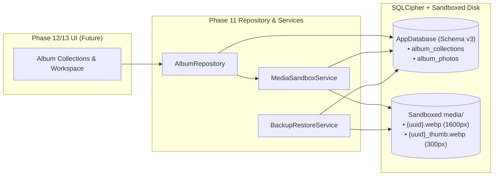

# Phase 11 Implementation Plan: Drift Schema v3 Migration, Media Pipeline & Album Repository

## Goal Description

Phase 11 establishes the local-first, encrypted persistence and sandboxed media foundation for **Milestone 3.5: Travel Memory Album (旅行影像纪念册)**. While **私人日记 (Private Diary)** handles daily linear rich-text entries (`Entries` + `MediaAttachments`), the **Travel Memory Album** module introduces structured photo collections (`AlbumCollections`) and annotated journey photos (`AlbumPhotos`), including literati travel metadata (`destinationTag` e.g. `"江南"` and `routeSummary` e.g. `"杭州 → 乌镇 → 苏州"`).

This phase upgrades `AppDatabase` from schema version `2` to `3`, extends `MediaSandboxService` with dual-resolution WebP ingestion (full-res + 300px thumbnail) and physical disk reclamation (`deleteCollectionAndMedia`), integrates both new tables into the AES-256-GCM `.mdbak` full-archive backup/restore engine with full v1/v2 backward compatibility, and exposes a clean reactive `AlbumRepository` for Phases 12 & 13.



---

## User Review Required

> [!IMPORTANT]
> **1. Literati Travel Album Schema Enhancements (`destinationTag` & `routeSummary`)**
> Based on the visual design reference (`云笺日记 / 旅行影集`), `AlbumCollections` includes two additional nullable columns beyond the base spec:
> - `destinationTag` (`TEXT`, nullable): Short regional stamp badge (e.g., `"江南"`, `"关西"`).
> - `routeSummary` (`TEXT`, nullable): Waypoint trajectory string (e.g., `"杭州 → 乌镇 → 苏州"`). `AlbumRepository` will support both manual override and automatic synthesis from distinct chronological photo `locationTag` values.

> [!NOTE]
> **2. `DateTimeColumn` Convention in Drift**
> Consistent with `entries.dart` and `media_attachments.dart`, all timestamp columns (`startDate`, `endDate`, `shotAt`, `createdAt`, `updatedAt`) are declared as `DateTimeColumn` in Drift (which stores Unix epoch integers in SQLite under the hood while providing type-safe `DateTime` objects in Dart and JSON serialization).

---

## Proposed Changes

### 1. Drift Schema v3 Migration (`lib/core/database/`)

#### [NEW] [album_collections.dart](file:///home/harry1029/projects/memodiary/lib/core/database/tables/album_collections.dart)
Define the `AlbumCollections` table representing a structured travel memory album:
```dart
import 'package:drift/drift.dart';

/// AlbumCollections table storing travel memory album metadata and cover styling.
@DataClassName('AlbumCollection')
class AlbumCollections extends Table {
  /// Unique collection UUID
  TextColumn get id => text()();

  /// Album title (1-100 chars, e.g., "江南春行纪")
  TextColumn get title => text().withLength(min: 1, max: 100)();

  /// Optional prologue / trip overview (卷首语)
  TextColumn get description => text().nullable()();

  /// Optional regional stamp tag (e.g., "江南", "川西")
  TextColumn get destinationTag => text().nullable()();

  /// Optional travel trajectory (e.g., "杭州 → 乌镇 → 苏州")
  TextColumn get routeSummary => text().nullable()();

  /// Optional relative sandboxed path to the cover WebP image (e.g., 'media/uuid.webp')
  TextColumn get coverImagePath => text().nullable()();

  /// Optional trip start date
  DateTimeColumn get startDate => dateTime().nullable()();

  /// Optional trip end date
  DateTimeColumn get endDate => dateTime().nullable()();

  /// Photobook layout preset identifier
  TextColumn get layoutPreset =>
      text().withDefault(const Constant('classic_photobook'))();

  /// Explicit display ordering index among collections
  IntColumn get sortIndex => integer().withDefault(const Constant(0))();

  /// Creation timestamp
  DateTimeColumn get createdAt => dateTime().withDefault(currentDateAndTime)();

  /// Last modification timestamp
  DateTimeColumn get updatedAt => dateTime().withDefault(currentDateAndTime)();

  @override
  Set<Column> get primaryKey => {id};
}
```

#### [NEW] [album_photos.dart](file:///home/harry1029/projects/memodiary/lib/core/database/tables/album_photos.dart)
Define the `AlbumPhotos` table with `onDelete: KeyAction.cascade` foreign key to `AlbumCollections`:
```dart
import 'package:drift/drift.dart';
import 'album_collections.dart';

/// AlbumPhotos table storing sandboxed photos and per-photo annotations (写影札).
@DataClassName('AlbumPhoto')
class AlbumPhotos extends Table {
  /// Unique photo record UUID
  TextColumn get id => text()();

  /// Parent collection ID (cascades on collection deletion)
  TextColumn get collectionId =>
      text().references(AlbumCollections, #id, onDelete: KeyAction.cascade)();

  /// Strictly relative sandboxed path to 1600px WebP image ('media/{uuid}.webp')
  TextColumn get relativeImagePath => text()();

  /// Strictly relative sandboxed path to 300px WebP thumbnail ('media/{uuid}_thumb.webp')
  TextColumn get relativeThumbnailPath => text()();

  /// Optional travel note / story reflection for this photo
  TextColumn get caption => text().nullable()();

  /// Optional location pin (e.g., "杭州 · 西湖", "Kyoto · Fushimi Inari")
  TextColumn get locationTag => text().nullable()();

  /// Optional capture timestamp (from EXIF or manual override)
  DateTimeColumn get shotAt => dateTime().nullable()();

  /// Explicit narrative sort order within the collection
  IntColumn get sortOrder => integer().withDefault(const Constant(0))();

  /// Cached width / height aspect ratio (default 1.0) for zero-decode layout synthesis
  RealColumn get aspectRatio => real().withDefault(const Constant(1.0))();

  /// Record creation timestamp
  DateTimeColumn get createdAt => dateTime().withDefault(currentDateAndTime)();

  @override
  Set<Column> get primaryKey => {id};
}
```

#### [MODIFY] [app_database.dart](file:///home/harry1029/projects/memodiary/lib/core/database/app_database.dart) & `app_database.g.dart`
- Import `tables/album_collections.dart` and `tables/album_photos.dart` and add `AlbumCollections, AlbumPhotos` to `@DriftDatabase(tables: [...])`.
- Enable `PRAGMA foreign_keys = ON;` in database setup so SQLite enforces `ON DELETE CASCADE` at runtime.
- Bump `schemaVersion` from `2` to `3`.
- In `onCreate`: create index `idx_album_photos_collection_order ON album_photos(collection_id, sort_order ASC);`.
- In `onUpgrade`:
  ```dart
  if (from < 3) {
    await m.createTable(albumCollections);
    await m.createTable(albumPhotos);
    await customStatement('''
      CREATE INDEX IF NOT EXISTS idx_album_photos_collection_order
      ON album_photos(collection_id, sort_order ASC);
    ''');
  }
  ```

---

### 2. Cascade File Deletion & Media Pipeline (`lib/core/services/`)

#### [MODIFY] [media_sandbox_service.dart](file:///home/harry1029/projects/memodiary/lib/core/services/media_sandbox_service.dart)
- Add value object `AlbumPhotoSandboxResult`:
  ```dart
  class AlbumPhotoSandboxResult {
    final String relativeImagePath;
    final String relativeThumbnailPath;
    final double aspectRatio;

    const AlbumPhotoSandboxResult({
      required this.relativeImagePath,
      required this.relativeThumbnailPath,
      required this.aspectRatio,
    });
  }
  ```
- Add `copyAndProcessAlbumPhoto(File sourceFile)`:
  - Compresses full-res image to `media/{uuid}.webp` (`minWidth: 1600, minHeight: 1600, quality: 80`).
  - Compresses thumbnail image to `media/{uuid}_thumb.webp` (`minWidth: 300, minHeight: 300, quality: 75`).
  - Computes image dimensions via `ui.instantiateImageCodec` (with `1.0` fallback in headless test environments) to return `aspectRatio`.
- Add `deleteCollectionAndMedia({required String collectionId, required AppDatabase database})`:
  - Queries the `AlbumCollection` and all linked `AlbumPhotos` for `collectionId`.
  - Collects a deduplicated `Set<String>` of all non-empty relative paths (`collection.coverImagePath`, `photo.relativeImagePath`, `photo.relativeThumbnailPath`).
  - Checks if any path is still referenced by another collection/photo before unlinking from `media/` via `deleteMedia(path)`.
  - Deletes the `AlbumPhotos` and `AlbumCollections` rows inside a database transaction.
- Add `deletePhotoAndMedia({required String photoId, required AppDatabase database})`:
  - Removes a single photo's physical `.webp` and `_thumb.webp` files (unless referenced as cover image) and deletes the `AlbumPhotos` row.

---

### 3. Full-Archive Backup Integration (`lib/features/import_export/`)

#### [MODIFY] [backup_manifest.dart](file:///home/harry1029/projects/memodiary/lib/features/import_export/models/backup_manifest.dart)
- Update `BackupDatabaseSnapshot` to include `final List<AlbumCollection> albumCollections` and `final List<AlbumPhoto> albumPhotos` (defaulting to `const []` in constructor and `fromJson` so legacy v1/v2 `.mdbak` backups restore cleanly without error).
- Bump `BackupManifest.maxSupportedSchemaVersion` from `2` to `3`.
- Include `'albumCollections'` and `'albumPhotos'` counts in `BackupManifest.toJson()['counts']`, `BackupResult`, and `RestoreResult`.

#### [MODIFY] [app_database.dart](file:///home/harry1029/projects/memodiary/lib/core/database/app_database.dart)
- Update `exportAllTablesSnapshot()` to query `select(albumCollections).get()` and `select(albumPhotos).get()`.
- Update `replaceAllFromBackup(BackupDatabaseSnapshot snapshot)`:
  - Delete order: `albumPhotos` $\rightarrow$ `albumCollections` $\rightarrow$ `mediaAttachments` $\rightarrow$ `entries` $\rightarrow$ `entries_fts` $\rightarrow$ `notebooks` $\rightarrow$ `templates`.
  - Insert order: `templates` $\rightarrow$ `notebooks` $\rightarrow$ `entries` $\rightarrow$ `mediaAttachments` $\rightarrow$ `albumCollections` $\rightarrow$ `albumPhotos` (verifying `photo.collectionId` exists in `validCollectionIds`).

#### [MODIFY] [backup_restore_service.dart](file:///home/harry1029/projects/memodiary/lib/features/import_export/services/backup_restore_service.dart)
- In `createBackup`: add `albumCollections.coverImagePath`, `albumPhotos.relativeImagePath`, and `albumPhotos.relativeThumbnailPath` to `candidateRelPaths`.
- In `restoreBackup`: validate that all `coverImagePath`, `relativeImagePath`, and `relativeThumbnailPath` entries in `manifest.snapshot` pass `MediaSandboxService.isStrictlyRelative(...)`.

---

### 4. AlbumRepository (`lib/features/albums/data/`)

#### [NEW] [album_repository.dart](file:///home/harry1029/projects/memodiary/lib/features/albums/data/album_repository.dart)
Create `AlbumRepository` encapsulating all SQLite queries and media cleanup seams:
- **Dependencies**: `AppDatabase database`, `MediaSandboxService mediaService`.
- **Collection Operations**:
  - `Future<AlbumCollection> createCollection({...})`
  - `Future<void> updateCollection(AlbumCollectionsCompanion companion)`
  - `Future<AlbumCollection?> getCollectionById(String id)`
  - `Future<List<AlbumCollection>> getAllCollections()` (ordered by `sortIndex ASC, createdAt DESC`)
  - `Stream<List<AlbumCollection>> watchAllCollections()`
  - `Stream<int> watchPhotoCountForCollection(String collectionId)`
  - `Future<void> reorderCollections(List<String> orderedCollectionIds)`
  - `Future<void> deleteCollection(String collectionId)` (delegates to `mediaService.deleteCollectionAndMedia`)
- **Photo Operations**:
  - `Future<AlbumPhoto> addPhoto({...})`
  - `Future<List<AlbumPhoto>> addPhotosBatch(String collectionId, List<AlbumPhotosCompanion> photos)` (inserts in a Drift `batch` and auto-sets `coverImagePath` on the parent collection if currently null)
  - `Future<void> updatePhotoAnnotation({required String photoId, String? caption, String? locationTag, DateTime? shotAt})`
  - `Future<List<AlbumPhoto>> getPhotosForCollection(String collectionId)` (ordered by `sortOrder ASC, createdAt ASC`)
  - `Stream<List<AlbumPhoto>> watchPhotosForCollection(String collectionId)`
  - `Future<void> reorderPhotos(String collectionId, List<String> orderedPhotoIds)` (updates `sortOrder` `0..N-1` inside a single SQLite transaction)
  - `Future<void> deletePhoto(String photoId)` (delegates to `mediaService.deletePhotoAndMedia`)
  - `Future<String?> synthesizeRouteSummary(String collectionId)` (aggregates distinct non-empty `locationTag`s in `sortOrder` into `"A → B → C"`)

---

## Verification Plan

### Automated Tests

1. **Schema v2 $\rightarrow$ v3 Migration & Cascade Test**:
   - Create [`test/core/database/schema_v3_migration_test.dart`](file:///home/harry1029/projects/memodiary/test/core/database/schema_v3_migration_test.dart)
   - Simulates a legacy v2 SQLite database (`PRAGMA user_version = 2`) with existing `entries`, upgrades to v3, verifies pre-existing entries are untouched, and verifies `album_collections` & `album_photos` table creation and `ON DELETE CASCADE` behavior.
2. **AlbumRepository & Physical Media Cleanup Test**:
   - Create [`test/features/albums/album_repository_test.dart`](file:///home/harry1029/projects/memodiary/test/features/albums/album_repository_test.dart)
   - Verifies collection CRUD, reactive watchers (`watchAllCollections`, `watchPhotosForCollection`), batch photo insertion, `reorderPhotos` transaction, `synthesizeRouteSummary`, and verifies `deleteCollectionAndMedia` / `deletePhotoAndMedia` physically remove `.webp` and `_thumb.webp` files from the temporary sandbox directory.
3. **Backup & Restore v3 Round-Trip + v2 Backward Compatibility Test**:
   - Update [`test/features/import_export/backup_manifest_test.dart`](file:///home/harry1029/projects/memodiary/test/features/import_export/backup_manifest_test.dart) and [`test/features/import_export/backup_restore_service_test.dart`](file:///home/harry1029/projects/memodiary/test/features/import_export/backup_restore_service_test.dart)
   - Verifies 100% field parity across `albumCollections` and `albumPhotos` + physical album WebP files during encrypted `.mdbak` backup & restore, and verifies restoring a v2 manifest (missing `albumCollections`/`albumPhotos` keys) succeeds cleanly.
4. **Static Analysis & Network Quarantine Audit**:
   ```bash
   flutter test test/core/database/schema_v3_migration_test.dart
   flutter test test/features/albums/album_repository_test.dart
   flutter test test/features/import_export/backup_manifest_test.dart
   flutter test test/features/import_export/backup_restore_service_test.dart
   flutter test test/hardening/network_quarantine_audit_test.dart
   flutter analyze
   ```
