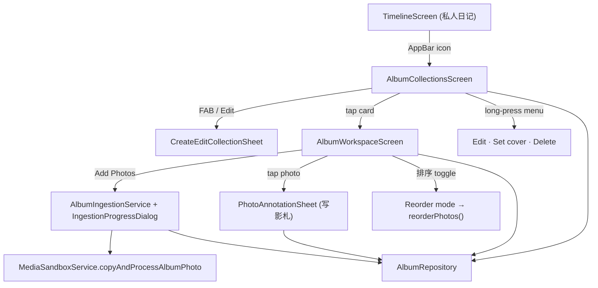

# Phase 12 Implementation Plan: Collection Management, Batch Ingestion & Photo Annotation Workspace

## Goal

Build the user-facing **旅行影集 (Travel Memory Album)** module on top of the Phase 11 data layer ([album_repository.dart](file:///home/harry1029/projects/memodiary/lib/features/albums/data/album_repository.dart), [media_sandbox_service.dart](file:///home/harry1029/projects/memodiary/lib/core/services/media_sandbox_service.dart)):

- a collections dashboard
- create/edit collection sheet
- batch photo ingestion with progress
- a workspace for reordering photos
- a per-photo annotation sheet (写影札)

All styling follows [.stitch/DESIGN.md](file:///home/harry1029/projects/memodiary/.stitch/DESIGN.md) via existing tokens and widgets (`InkDiaryTokens`, `XuanPaperCard`, `CinnabarSealBadge`, `InkMetadataPill`). Widgets talk to the database only through `AlbumRepository` and the new `AlbumIngestionService`.



---

## User Review Required

> [!IMPORTANT]
> **Phase 11 carry-over fixes (in scope here):**
> 1. In Phase 11 I edited `app_database.g.dart` **by hand** to add the `ON DELETE CASCADE` custom constraint to `album_photos.collection_id`, and I didn't re-run `build_runner` afterwards. I'll re-run `dart run build_runner build` and check that the generated output still has the constraint and that no hand edits are left.
> 2. Remove a leftover no-op line in `album_repository_test.dart` (`sampleImageBytes = MediaSandboxService.generateProceduralVideoPoster`).

> [!WARNING]
> **Not using `Isolate.run`, unlike what CODING_STANDARDS asks for batch ingestion.** `flutter_image_compress` calls native code through platform channels, so it can't run inside a plain `Isolate.run` without extra `BackgroundIsolateBinaryMessenger` setup. The native codec already does its work off the UI thread. So the service will:
> - process photos one at a time on the main isolate, awaiting each one and yielding between items
> - insert all the database rows in one `addPhotosBatch` transaction
>
> The UI stays responsive, and I'll note this exception in a code comment.

---

## Open Questions (each has a recommended default)

> [!IMPORTANT]
> **Q1 — Where do users enter the Albums module?**
> The app has no hub screen yet; `TimelineScreen` is the home screen.
> - **(Recommended) A:** Add an AppBar icon on `TimelineScreen` (`Icons.photo_album_outlined`, tooltip `旅行影集`, key `timeline_albums_button`). This matches how Weekly Review, Search and Settings are already opened.
> - **B:** Build the two-card home hub from your mockup (私人日记 / 旅行日记) now. It's a bigger UI change, and I'd suggest a separate phase for it.

> [!IMPORTANT]
> **Q2 — How should we read EXIF capture dates?** There's no EXIF package in `pubspec.yaml`.
> - **(Recommended) A:** Write a small pure-Dart reader (`ExifDateReader`, about 120 lines) that reads `DateTimeOriginal` (0x9003) and falls back to `DateTime` (0x0132) from the JPEG APP1/TIFF block. It adds no dependency and can be unit-tested with byte fixtures. HEIC/PNG files fall back to `DateTime.now()`.
> - **B:** Add `exif` (pub.dev, MIT, pure Dart). This needs network access for `pub get`.
> - In both cases the original source file is read **before** WebP compression, because compression strips EXIF.

> [!IMPORTANT]
> **Q3 — Drag-and-drop UX.** Flutter has no built-in reorderable *grid*.
> - **(Recommended) A:** Browse in an adaptive `GridView` of thumbnails, and add a **「排序」 toggle** that switches to a `ReorderableListView` (thumbnail, caption, drag handle). It has no dependencies, works with screen readers, and is reliable to test.
> - **B:** Build a custom 2D grid with `LongPressDraggable` + `DragTarget`. It looks closer to a true grid drag, but it's harder to make accessible and to test.

> [!NOTE]
> **Q4 — Cancelling mid-import.** Default: photos already processed are **kept and committed**. Photos not yet processed are skipped. A file that fails is skipped and counted, and the summary shows something like `已导入 28 张，2 张失败`.

---

## Proposed Changes

### 1. Data layer additions

#### [MODIFY] [album_repository.dart](file:///home/harry1029/projects/memodiary/lib/features/albums/data/album_repository.dart)
New methods (unit-tested):
```dart
Stream<AlbumCollection?> watchCollectionById(String id);
Stream<Map<String, int>> watchPhotoCounts();            // one GROUP BY query for the whole dashboard
Future<void> setCollectionCover(String collectionId, String photoId);
/// Re-synthesizes routeSummary only if it is currently null or equal to the
/// synthesized value computed BEFORE the edit (i.e. it was auto-generated).
Future<void> updatePhotoAnnotationAndSyncRoute({
  required String photoId,
  Value<String?> caption, Value<String?> locationTag, Value<DateTime?> shotAt,
});
```
**Detecting an auto-generated route without a schema change:** before saving an edit, compute `synthesizeRouteSummary(collectionId)`. If the stored `routeSummary` is `null` or equals that value, the route was auto-generated, so regenerate and save it after the edit. If it differs, the user wrote it manually, so leave it alone.

#### [NEW] `lib/features/albums/services/exif_date_reader.dart` (if Q2 = A)
`static Future<DateTime?> readCaptureDate(File source)`. It reads only the first 128 KB, handles both TIFF byte orders, parses `yyyy:MM:dd HH:mm:ss`, and returns `null` on any malformed input. It never throws.

#### [NEW] `lib/features/albums/services/album_ingestion_service.dart`
```dart
class IngestionProgress { final int processed, total, failed; final bool isDone, isCancelled; }
class IngestionResult  { final int imported, failed; final bool wasCancelled; }

class AlbumIngestionService {
  static const int maxBatchSize = 50;
  AlbumIngestionService({required AlbumRepository repository,
                         required MediaSandboxService mediaService,
                         Future<DateTime?> Function(File)? captureDateReader,
                         DateTime Function()? clock});
  /// Sequential: read EXIF → copyAndProcessAlbumPhoto → build companion.
  /// One addPhotosBatch() transaction at the end (or on cancel).
  Future<IngestionResult> ingest({
    required String collectionId,
    required List<File> sources,
    void Function(IngestionProgress)? onProgress,
    bool Function()? isCancelled,
  });
}
```
- `sortOrder` continues after the current maximum.
- If more than 50 files are selected, the first 50 are kept and the UI shows a SnackBar.
- Files that fail are skipped, and any half-written WebP files are deleted.

---

### 2. Shared album widgets (`lib/features/albums/widgets/`)

#### [NEW] `sandboxed_album_image.dart`
`SandboxedAlbumImage(relativePath, mediaService, {cacheWidth, fit, borderRadius})`. It resolves the sandboxed file through `FutureBuilder`, decodes with `cacheWidth` so grids never decode the full 1600px image, and shows a placeholder in the `agedFiber` color with `Icons.landscape_outlined` when the file is missing.

#### [NEW] `album_collection_card.dart`
Built on `XuanPaperCard` (pure leaf `#FAF7F0`, 1px deckle border, 12px radius), with liubai spacing:
```
┌───────────────────────────────────┐
│ 江南春行纪               [江南]印  │  ← title (Noto Serif headlineSmall) + CinnabarSealBadge.compact(destinationTag)
│ 山河沿路，笔底留痕                 │  ← description, 1 line, danmo
│ ┌───────────────────────────────┐ │
│ │      cover (16:9, cacheW 720) │ │
│ └───────────────────────────────┘ │
│ 📍 杭州 → 乌镇 → 苏州              │  ← route (ellipsis, maxLines 1)
│ [2026.04.01 – 04.05]  [32 张]      │  ← InkMetadataPill ×2 (clamped text scale ≤1.3)
└───────────────────────────────────┘
```
Keys: `album_card_<id>`, `album_card_menu_<id>`. Long-press, or the trailing `more_horiz` button (size 20), opens the contextual menu. Semantics: the card reads its title, date range and photo count, and the menu button has its own label `更多操作：<title>`.

#### [NEW] `create_edit_collection_sheet.dart`
A modal bottom sheet (`isScrollControlled`, `viewInsets` padding, `SingleChildScrollView`) with a `Form`:

| Field | Key | Validation |
|---|---|---|
| 标题 | `album_form_title` | required, trimmed 1–100 chars |
| 卷首语 | `album_form_description` | optional, multiline |
| 地域印 (destinationTag) | `album_form_destination` | optional, ≤ 8 chars (seal size) |
| 旅途路线 (routeSummary) | `album_form_route` | optional; helper text: 「留空则根据照片地点自动生成」 |
| 行程日期 | `album_form_date_range` | optional `showDateRangePicker`, clear button |

Submit button `album_form_submit` (an ink `FilledButton`). It returns a typed `CollectionFormResult` and doesn't call the repository itself, so the caller decides between create and update. That keeps the sheet a pure form and easy to test. In edit mode the fields are pre-filled.

#### [NEW] `ingestion_progress_dialog.dart`
A non-dismissible dialog driven by a `ValueListenable<IngestionProgress>`. It shows `LinearProgressIndicator` (cinnabar), the text `正在导入第 12 / 30 张照片…`, and a 「停止」 button (`album_ingest_cancel`). It closes itself when the import finishes.

#### [NEW] `photo_annotation_sheet.dart` (写影札)
A `DraggableScrollableSheet` (initial 0.9) containing:
- a full-resolution preview (`relativeImagePath`, `InteractiveViewer` for pinch-zoom, aspect from cached `aspectRatio`)
- 札记 caption (multiline, borderless canvas, bottom-ink focus line per DESIGN.md) — `annotation_caption_field`
- 地点 location tag with `Icons.place_outlined` — `annotation_location_field`
- 拍摄时间 date picker row with a clear button — `annotation_date_tile`
- actions: 保存 (`annotation_save`), 设为封面 (`annotation_set_cover`; shows a seal "封面" when the photo is already the cover), 删除 (`annotation_delete`, with a confirmation dialog)

Save calls `updatePhotoAnnotationAndSyncRoute`.

---

### 3. Screens (`lib/features/albums/screens/`)

#### [NEW] `album_collections_screen.dart`
- `StreamBuilder` over `watchAllCollections()` combined with `watchPhotoCounts()`
- Responsive layout: one column below 600px width, and a two-column `SliverGrid` above that, with content max width 960
- Empty state: a centered ink brush icon, `尚无旅行影集` with `山河沿路，笔底留痕`, and a 「新建影集」 button
- FAB (cinnabar, `albums_add_fab`) opens the create sheet → `createCollection`
- Contextual menu:
  - **编辑** → sheet in edit mode → `updateCollection`
  - **设封面** → a grid picker of the collection's thumbnails → `setCollectionCover`
  - **删除** → confirmation dialog (`album_delete_confirm`) stating that the photos will be permanently removed from the device → `deleteCollection` (disk + database)

#### [NEW] `album_workspace_screen.dart`
- Header: title, destination seal, date range, prologue, and a **route banner** (an `agedFiber` strip with waypoint dots). Editing the metadata reuses the create/edit sheet.
- Body (browse mode): adaptive `SliverGrid` with `maxCrossAxisExtent: 140`, square thumbnails using `relativeThumbnailPath`, a small caption indicator dot, and a cover marker. Tapping a photo opens `PhotoAnnotationSheet`.
- 「排序」 toggle (`workspace_reorder_toggle`) switches to `ReorderableListView` (keys `reorder_tile_<id>`). `onReorder` updates the list optimistically, then calls `reorderPhotos`.
- 「添加照片」 (`workspace_add_photos`) → `ImagePicker.pickMultiImage(limit: 50)` → progress dialog → `AlbumIngestionService.ingest` → summary SnackBar.
- Constructor seams for tests: `ImagePicker? imagePicker`, `AlbumIngestionService? ingestionService`.

---

### 4. Navigation (if Q1 = A)

#### [MODIFY] [timeline_screen.dart](file:///home/harry1029/projects/memodiary/lib/features/timeline/screens/timeline_screen.dart)
Add an AppBar `IconButton` (key `timeline_albums_button`, tooltip `旅行影集`) before Search. It pushes `AlbumCollectionsScreen(database, mediaService)`, which builds its own `AlbumRepository`.

---

## Verification Plan

### Automated tests (`test/features/albums/`)
Shared harness `album_test_harness.dart`:
- `pumpAlbumScreen(tester, child)`: phone viewport 390×844, `InkDiaryTheme.light`, in-memory DB, temp sandbox, fake compressor
- **Drift stream hygiene:** close the DB with `addTearDown`, then `pump(Duration.zero)` to clear drift's pending stream-cancel timer

| File | Covers |
|---|---|
| `exif_date_reader_test.dart` | Little- and big-endian JPEG fixtures with DateTimeOriginal; DateTime-only fallback; non-JPEG/truncated → `null` |
| `album_ingestion_service_test.dart` | 3-file import (order, EXIF vs clock fallback, cover auto-set); 50-file cap; one failing file skipped and its partial files removed; cancel after 2 → 2 committed; progress callback sequence |
| `album_repository_test.dart` (extend) | `setCollectionCover`, `watchPhotoCounts`, `watchCollectionById`, route sync: auto route regenerates and manual route is preserved |
| `album_collections_screen_test.dart` | Empty state; cards render title, route, count and date pills; delete dialog → cancel keeps the collection, confirm removes the row and files |
| `create_edit_collection_sheet_test.dart` | Empty title blocked; >100 chars blocked; valid submit returns a correct `CollectionFormResult`; edit mode pre-fills |
| `album_workspace_screen_test.dart` | Thumbnails render in `sortOrder`; reorder toggle → `ReorderableListView`; simulated drag persists the new `sortOrder`; Add Photos with a fake picker → progress dialog → photos appear |
| `photo_annotation_sheet_test.dart` | Caption and location save; set-as-cover updates the collection; delete removes the photo and its files; auto route refreshes after a location edit |
| `timeline_screen_test.dart` (extend) | The `timeline_albums_button` opens `AlbumCollectionsScreen` |

```bash
dart run build_runner build                         # Phase 11 carry-over: regenerate .g.dart
flutter test test/features/albums/
flutter test test/features/timeline/timeline_screen_test.dart
flutter test test/hardening/network_quarantine_audit_test.dart
flutter test                                        # full regression
flutter analyze                                     # target: No issues found
```

### Manual verification (device/emulator)
1. Timeline → 旅行影集 icon → empty state → create 「江南春行纪」 with seal 江南.
2. Add about 30 gallery photos: the progress dialog counts up, and capture dates match the gallery.
3. Turn on 排序, drag a photo, go back and reopen: the order is kept.
4. Tap a photo and set location tags 杭州 / 乌镇 / 苏州: the route banner updates automatically.
5. Delete the collection: `media/` no longer contains its `.webp` files.
