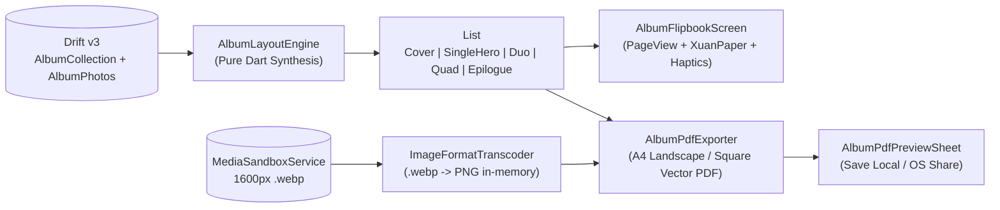

# Milestone 3.5 — Phase 13: Keepsake Synthesis Engine, Interactive In-App Viewer & PDF Photobook Export

## Goal Description
Complete **Milestone 3.5 (Travel Memory Album / 旅行影像纪念册)** by compiling user-curated `AlbumCollection` and ordered `AlbumPhoto` items into a tangible literati keepsake album—experienced both as an interactive in-app flipbook (`AlbumFlipbookScreen`) and an offline, print-ready vector PDF photobook (`AlbumPdfExporter`).

---

## Technical Watchpoints Guarded During Execution

### 1. PDF Single-Page Hard Bounds (Preventing `TooManyPagesException`)
- **The Risk**: Unlike Flutter widgets that can scroll or wrap, a PDF page has rigid physical boundaries. If an `AlbumSpread` container, expanded column, or multiline caption exceeds the page height, the `pdf` package will either silently clip text or throw a fatal `TooManyPagesException` when layout fails to fit on a single page.
- **The Guard**: In `AlbumPdfExporter`, ensure every spread layout strictly bounds text and flex components:
  - Wrap captions and prologues with explicit maximum line limits: `pw.Text(..., maxLines: 4, overflow: pw.TextOverflow.clip)`.
  - Constrain images using `pw.BoxFit.contain` or `pw.Expanded` inside fixed-height flex containers to guarantee all spread elements fit predictably within the page format margins without spilling across pages.

### 2. Aspect Ratio Preservation in PDF Duo and Quad Spreads
- **The Risk**: On `a4Landscape` (wide 841.89 × 595.28 pt) and `square` (210 × 210 mm) page formats, side-by-side or 2×2 grid photo cells will distort portrait (tall) photos if images default to unconstrained `pw.BoxFit.fill`.
- **The Guard**: Enforce `pw.BoxFit.cover` inside clipped rectangular boxes (`pw.ClipRect` / `pw.ClipRRect`) or `pw.BoxFit.contain` with background letterboxing on all PDF image frames. This ensures image proportions remain pristine regardless of whether photos are portrait, square, or landscape.

### 3. PageView Controller & Gesture Disposing in Widget Tests
- **The Risk**: `PageView` and horizontal drag physics run fling animations, scroll physics, and tickers that can leave pending microtasks or timers if tests terminate before animations settle, causing `fakeAsync` leak warnings and test failures.
- **The Guard**: In `album_flipbook_screen_test.dart`:
  - Always use `await tester.pumpAndSettle()` after swipe or navigation button actions.
  - Ensure `PageController` is cleanly disposed of in `AlbumFlipbookScreenState.dispose()`.
  - Execute `await tearDownAlbumScreen(tester)` (`await tester.pumpWidget(const SizedBox.shrink()); await tester.pump(const Duration(milliseconds: 100));`) in all test cases to drain any remaining stream or ticker timers before Flutter's invariant verification checks run.

---

## Architecture & Component Design

### 1. Album Layout Synthesis Engine (`lib/features/albums/models/album_spread.dart` & `lib/features/albums/services/album_layout_engine.dart`)

#### `AlbumSpread` Sealed Model Hierarchy
- **`AlbumSpread`** (sealed base class):
  - `int pageNumber` (1-based index in the compiled sequence)
- **`CoverSpread`**:
  - `String title`, `String? description` (prologue), `String? destinationTag`, `DateTime? startDate`, `DateTime? endDate`, `int photoCount`, `String? coverImagePath` (resolved from `collection.coverImagePath` or fallback to the first photo's `relativeImagePath`).
- **`SingleHeroSpread`**:
  - `AlbumPhoto photo` — high-impact full-page spread displaying a single photo, its extended caption (`写影札`), location badge (`locationTag`), and capture date (`shotAt`).
- **`DuoSpread`**:
  - `AlbumPhoto firstPhoto`, `AlbumPhoto secondPhoto`, `DuoLayoutOrientation orientation` (`sideBySide` for two portrait/square photos, `stacked` when at least one photo is wide landscape `aspectRatio >= 1.25`).
- **`QuadSpread`**:
  - `List<AlbumPhoto> photos` (3 to 4 compact detail photos in a 2×2 literati grid with concise location/caption metadata pills).
- **`EpilogueSpread`**:
  - `String title`, `String? routeSummary` (e.g., `"杭州 → 乌镇 → 苏州"` synthesized from `collection.routeSummary` or ordered photo `locationTag`s), `int totalPhotos`, `int totalLocations`, `String sealText` (defaults to `destinationTag` or `"拾光"`).

#### Deterministic Layout Heuristics (`AlbumLayoutEngine.synthesize`)
Given `AlbumCollection collection` and ordered `List<AlbumPhoto> photos`:
1. **Always prepend `CoverSpread`** (`pageNumber = 1`).
2. **Body Spread Clustering** (iterating with cursor `index` over `photos`, respecting `collection.layoutPreset`):
   - **Hero Promotion Rule**: A photo at `photos[index]` is promoted to a standalone `SingleHeroSpread` if:
     - `collection.layoutPreset == 'editorial'` and `index == 0` (opening hero shot), OR
     - Its trimmed `caption` length is `>= 60` characters (extended literati reflection requiring dedicated reading space), OR
     - It is panoramic (`aspectRatio >= 1.6` or `aspectRatio <= 0.6`), OR
     - Only 1 photo remains at the end of the list.
   - **Quad Grid Rule**: If at least 4 photos remain (`remaining >= 4`) and the next 4 photos all have short/empty captions (`< 25` chars) and none is panoramic (`0.75 <= aspectRatio <= 1.45`), group the 4 photos into a `QuadSpread` (or 3 photos if `remaining == 3` and all 3 have short/empty captions `< 25` chars).
   - **Duo Pairing Rule**: If at least 2 photos remain and the second photo does not demand a standalone `SingleHeroSpread` (`caption.length < 60` and non-panoramic), pair `photos[index]` and `photos[index + 1]` into a `DuoSpread`:
     - `DuoLayoutOrientation.sideBySide` if both photos have `aspectRatio <= 1.15` (portrait/square pair).
     - `DuoLayoutOrientation.stacked` otherwise.
   - **Fallback**: Emit `SingleHeroSpread` for `photos[index]`.
3. **Always append `EpilogueSpread`** (`pageNumber = totalSpreads`) containing the full route trajectory (`"杭州 → 乌镇 → 苏州"`), trip statistics, and vermilion Cinnabar seal (`CinnabarSealBadge`).

---

### 2. Interactive In-App Flipbook Viewer (`lib/features/albums/screens/album_flipbook_screen.dart` & `lib/features/albums/widgets/album_spread_card.dart`)

- **Workspace Entry Point** ([album_workspace_screen.dart](file:///home/harry1029/projects/memodiary/lib/features/albums/screens/album_workspace_screen.dart)):
  - Add a prominent `"生成影卷 / 浏览画册"` action bar / button (`key: const Key('workspace_open_flipbook_button')`) in `AlbumWorkspaceScreen`'s collection header (and AppBar icon button `key: const Key('workspace_flipbook_icon_button')`) that navigates to `AlbumFlipbookScreen`.
- **`AlbumFlipbookScreen`**:
  - Compiles spreads synchronously via `AlbumLayoutEngine.synthesize(collection: collection, photos: photos)`.
  - **`PageView.builder`** (`key: const Key('flipbook_page_view')`) with horizontal paging physics (`BouncingScrollPhysics`) and `onPageChanged` triggering `HapticFeedback.selectionClick()`.
  - **Fullscreen Chrome Toggle**: Wrapping the viewport in a `GestureDetector(onTap: _toggleFullscreen)` (`key: const Key('flipbook_fullscreen_toggle')`) smoothly toggles the top AppBar and bottom control bar (`AnimatedOpacity` / visibility state) for distraction-free viewing.
  - **Clean Lifecycle & Resource Disposing**: Dedicated `PageController` cleanly created in `initState()` and disposed of in `dispose()`.
  - **Bottom Navigation & Indicator Bar**:
    - Displays page progress pill `"第 X / Y 页"` (`key: const Key('flipbook_page_indicator')`) using `InkDiaryTheme.fontNotoSerif`.
    - Previous/Next page buttons (`flipbook_prev_page_button`, `flipbook_next_page_button`) for accessibility and quick stepping.
    - `"导出画册 PDF"` button (`key: const Key('flipbook_export_pdf_button')`) opening `AlbumPdfPreviewSheet`.
- **`AlbumSpreadCard`** (`lib/features/albums/widgets/album_spread_card.dart`):
  - Renders each `AlbumSpread` variant inside a literati `XuanPaperCard` with double hairline inner framing (`tokens.deckleBorder`), `tokens.xuanPureLeaf` / `tokens.agedFiber` paper surfaces, `CinnabarSealBadge` imprints, and `SandboxedAlbumImage` (using full-res `relativeImagePath` on `CoverSpread` and `SingleHeroSpread`, and 300px/800px cached paths on `DuoSpread` and `QuadSpread`).

---

### 3. High-Fidelity Vector PDF Photobook Export (`lib/features/albums/services/album_pdf_exporter.dart` & `lib/features/albums/widgets/album_pdf_preview_sheet.dart`)

- **`AlbumPdfExporter`**:
  - Supports two photobook page formats (`AlbumPdfPageFormat` enum):
    - `a4Landscape` (`PdfPageFormat.a4.landscape` — 841.89 × 595.28 pt, default for travel photobooks)
    - `square` (`PdfPageFormat(595.28, 595.28)` — 210 × 210 mm classic square keepsake book)
  - **Single-Page Hard Bounds Guard**: Fixed-height flex containers and clamped text lengths (`maxLines: 4`, `overflow: pw.TextOverflow.clip`) to prevent `TooManyPagesException`.
  - **Aspect Ratio Preservation Guard**: All photo cells use `pw.BoxFit.cover` inside `pw.ClipRect` / `pw.ClipRRect` or `pw.BoxFit.contain` with neutral letterbox framing to ensure zero distortion on both landscape and square book formats.
  - **100% Offline & Injectable Transcoding**:
    - Resolves each photo's `relativeImagePath` via `MediaSandboxService.getFileFromRelativePath`, reads bytes synchronously (`file.existsSync()` / `file.readAsBytesSync()`), and converts WebP to PNG in-memory via `ImageFormatTranscoder.ensurePdfCompatibleBytes(rawBytes, customTranscoder: imageTranscoder)`.
    - Accepts an optional `Future<Uint8List> Function(Uint8List)? imageTranscoder` parameter so widget and unit tests inside `FakeAsync` can inject a deterministic fast transcoder without stalling on `dart:ui` native codecs.
  - **Vector Xuan Paper & Double-Hairline Framing**:
    - Background fill in warm Xuan paper (`#FCF9F2`), outer border (`1.2pt`, `#D8D1C3`) + inner hairline border (`0.5pt`, inset by `4pt`), matching `.stitch/DESIGN.md` and the reference literati card aesthetic.
    - Renders `CoverSpread`, `SingleHeroSpread`, `DuoSpread`, `QuadSpread`, and `EpilogueSpread` with vector Cinnabar seal stamps (`#B83B2E`), route trajectory banners, sanitized CJK/Latin typography via `PdfFontResolver`, and footer page numbers (`"第 X / Y 页"` or `"Page X of Y"`).
- **`AlbumPdfPreviewSheet`** (`lib/features/albums/widgets/album_pdf_preview_sheet.dart`):
  - Modal sheet allowing the user to toggle between **A4 横版画册 (A4 Landscape)** and **方册画幅 (Square)**, see page/photo count summary, and:
    1. **保存 PDF 至本地** (`key: const Key('album_pdf_save_button')`): Generates the PDF and writes it to the app documents/temp directory (or custom injectable save handler), showing a confirmation `SnackBar`.
    2. **分享 / 打印画册** (`key: const Key('album_pdf_share_button')`): Calls `Printing.sharePdf` (or injectable share callback for testing) to invoke the native OS share/print sheet.

---

## Files to Create & Modify

### New Files
1. `lib/features/albums/models/album_spread.dart` — Sealed `AlbumSpread` hierarchy (`CoverSpread`, `SingleHeroSpread`, `DuoSpread`, `QuadSpread`, `EpilogueSpread`) and `DuoLayoutOrientation` enum.
2. `lib/features/albums/services/album_layout_engine.dart` — Pure Dart deterministic layout compiler (`AlbumLayoutEngine.synthesize`).
3. `lib/features/albums/widgets/album_spread_card.dart` — Flutter widget rendering each `AlbumSpread` inside a double-hairline `XuanPaperCard` canvas.
4. `lib/features/albums/screens/album_flipbook_screen.dart` — Interactive `PageView` flipbook viewer with haptic page turns, `"第 X / Y 页"` indicator, single-tap fullscreen chrome toggle, and PDF export action.
5. `lib/features/albums/services/album_pdf_exporter.dart` — High-fidelity vector PDF photobook generator (`a4Landscape` & `square`) with single-page bounded flex layouts, aspect ratio preservation, WebP-to-PNG transcoding, double-hairline literati borders, and Cinnabar seals.
6. `lib/features/albums/widgets/album_pdf_preview_sheet.dart` — Format selector (A4 Landscape vs Square) and 1-tap local PDF save / OS share sheet.
7. `test/features/albums/album_layout_engine_test.dart` — Unit tests for `AlbumLayoutEngine` covering empty, single, duo, quad, long-caption hero promotion, panoramic hero promotion, and epilogue trajectory synthesis.
8. `test/features/albums/album_flipbook_screen_test.dart` — Widget tests for `AlbumFlipbookScreen` and workspace entry navigation, page indicator updates, single-tap fullscreen toggle, `pumpAndSettle()` flings, and `tearDownAlbumScreen(tester)` stream teardown.
9. `test/features/albums/album_pdf_exporter_test.dart` — Unit/integration tests for `AlbumPdfExporter` and `AlbumPdfPreviewSheet` verifying `%PDF-` header bytes, exact single-page bounds without `TooManyPagesException`, aspect ratio preservation, and WebP transcoding across A4 Landscape and Square formats.

### Modified Files
1. [album_workspace_screen.dart](file:///home/harry1029/projects/memodiary/lib/features/albums/screens/album_workspace_screen.dart) — Add `"生成影卷 / 浏览画册"` button in the collection header and AppBar action to launch `AlbumFlipbookScreen`.

---

## Verification Plan & Hardening Checks

1. **Static Analysis**:
   - Run `flutter analyze` and confirm **0 errors, 0 warnings, 0 lints**.
2. **Unit Tests (`album_layout_engine_test.dart`)**:
   - Empty collection (0 photos) produces `[CoverSpread, EpilogueSpread]` (2 pages).
   - Single photo collection produces `[CoverSpread, SingleHeroSpread, EpilogueSpread]` (3 pages).
   - Long caption (`>= 60` chars) and panoramic (`aspectRatio >= 1.6`) photos promote to `SingleHeroSpread`.
   - Portrait/square pairs (`aspectRatio <= 1.15`) produce `DuoSpread(orientation: sideBySide)` while wide landscape pairs produce `DuoSpread(orientation: stacked)`.
   - 4 consecutive short-caption standard-aspect photos cluster into `QuadSpread`.
   - `EpilogueSpread` synthesizes `"杭州 → 乌镇 → 苏州"` trajectory and deduplicated location count.
3. **Widget Tests (`album_flipbook_screen_test.dart`)**:
   - Launching from `AlbumWorkspaceScreen`'s `"生成影卷 / 浏览画册"` button opens `AlbumFlipbookScreen`.
   - Page indicator starts at `"第 1 / N 页"` and updates as the user swipes or taps next/previous page buttons.
   - Single tap on the flipbook viewport toggles fullscreen chrome visibility.
   - All fling/scroll interactions use `await tester.pumpAndSettle()`, and `tearDownAlbumScreen(tester)` verifies zero pending timers or leaked tickers.
4. **PDF Photobook Tests (`album_pdf_exporter_test.dart`)**:
   - Exporting a multi-spread collection in both `AlbumPdfPageFormat.a4Landscape` and `AlbumPdfPageFormat.square` produces valid non-empty `%PDF-1.` byte payloads with expected `/Count` page entries and transcoded sandboxed `.webp` images.
   - Verify strict single-page layout bounds prevent `TooManyPagesException` even with lengthy captions or multi-image spreads.
   - Verify non-distorted aspect ratio preservation on both formats.
5. **Full Regression & Network Quarantine Audit**:
   - Run full `flutter test` across the entire repository (all 244+ existing tests + new Phase 13 tests) and verify `test/hardening/network_quarantine_audit_test.dart` passes (`10/10`, 0 network permissions or sockets).
