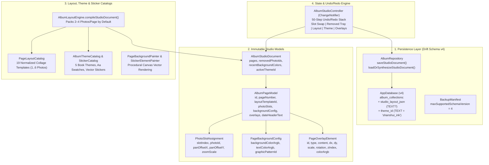

# Phase 14 Implementation Plan: Studio Data Model, Collage Layout Library, Book Themes & Sticker/Background Engine

## Goal Description

Phase 14 establishes the foundation of **Intermediate Milestone 3.6 (DIY Photobook Studio & Interactive Scrapbook Editor)**:
1. **Studio Page & Canvas Persistence (Drift Schema v4)**: Upgrades `AppDatabase` from schema version 3 to 4, adding `studio_layout_json` and `theme_id` to `album_collections` with non-destructive `onUpgrade` migration and full `.mdbak` `BackupManifest` round-trip compatibility.
2. **Multi-Photo Collage Layout Catalog**: Defines 19 normalized (`0.0..1.0`) multi-photo collage layout templates for 1 to 6 photos per page (including optional date header slots) and upgrades `AlbumLayoutEngine` to compile initial studio documents that pack 2 to 4 photos per page into rich multi-photo layouts by default.
3. **Themes & Style Catalog + Procedural Background & Sticker Painters**: Provides 5 curated book themes (`shanshui_ink`, `jardin`, `abstract_blue`, `day_at_beach`, `playful_rainbow`), suggested color swatches with auto-contrasting `Aa` text colors, 9 procedural vector background patterns (`PageBackgroundPainter`), and a built-in vector `StickerCatalog`.
4. **AlbumStudioController with 50-Step Undo/Redo History**: A `ChangeNotifier` state & command engine managing slot swapping, the "Removed" holding tray lifecycle ($N \leftrightarrow N+1$ automatic layout transitions), layout switching, background/graphic customization, global theme application, and overlay transformations with `AlbumRepository` persistence.

---

## Architecture Overview



---

## Technical Watchpoints & Safeguards

> [!IMPORTANT]
> **Watchpoint 1: Backward-Compatible Deserialization for Legacy v3 Backups & Test Fixtures**
> Existing tests and `.mdbak` v3 backups instantiate `AlbumCollection` or call `AlbumCollection.fromJson` without `studioLayoutJson` or `themeId`.
> - **Guard**: In `app_database.g.dart`, give `this.themeId = 'shanshui_ink'` a default value in the `AlbumCollection` constructor, and in `AlbumCollection.fromJson`, fall back to `'shanshui_ink'` when `json['themeId'] == null`.

> [!IMPORTANT]
> **Watchpoint 2: Normalized Slot Geometry Bounds (`0.0..1.0`)**
> Every `PageLayoutTemplate` slot `Rect` and optional `dateHeaderSlot` must stay strictly within `[0.0, 1.0]` with positive width/height and non-overlapping photo cells so both the interactive Flutter canvas (Phase 15) and the vector PDF renderer (Phase 16) can scale coordinates deterministically to any page aspect ratio.

> [!IMPORTANT]
> **Watchpoint 3: Removed Tray $(N \leftrightarrow N+1)$ Auto-Layout Transitions**
> When removing a photo from a page with $N$ photos to the "Removed" tray, the page must automatically transition to a valid $(N-1)$-photo layout template (or an empty canvas if $N-1 = 0$) and re-index `slotIndex` values `0..N-2`. Conversely, restoring a photo from the tray onto a page with $N$ photos (where $N < 6$) must auto-select an $(N+1)$-photo template from `PageLayoutCatalog` and assign the restored photo to slot $N$.

---

## Proposed Changes

### 1. Drift Schema v4 & Backup Manifest

#### [MODIFY] [album_collections.dart](file:///home/harry1029/projects/memodiary/lib/core/database/tables/album_collections.dart)
- Add `studioLayoutJson` and `themeId` columns to `AlbumCollections`:
```dart
  /// Optional serialized JSON of AlbumStudioDocument for DIY scrapbook layouts
  TextColumn get studioLayoutJson => text().nullable()();

  /// Active book theme identifier (defaults to 'shanshui_ink')
  TextColumn get themeId =>
      text().withDefault(const Constant('shanshui_ink'))();
```

#### [MODIFY] [app_database.dart](file:///home/harry1029/projects/memodiary/lib/core/database/app_database.dart)
- Bump `schemaVersion` from `3` to `4`.
- In `migration.onUpgrade`:
```dart
          if (from < 4) {
            await m.addColumn(
              albumCollections,
              albumCollections.studioLayoutJson,
            );
            await m.addColumn(albumCollections, albumCollections.themeId);
          }
```

#### [MODIFY] [app_database.g.dart](file:///home/harry1029/projects/memodiary/lib/core/database/app_database.g.dart)
- Update `$AlbumCollectionsTable`, `AlbumCollection`, and `AlbumCollectionsCompanion` with `studioLayoutJson` (`studio_layout_json`) and `themeId` (`theme_id`, defaulting to `'shanshui_ink'`).

#### [MODIFY] [backup_manifest.dart](file:///home/harry1029/projects/memodiary/lib/features/import_export/models/backup_manifest.dart)
- Update `maxSupportedSchemaVersion` from `3` to `4`.

---

### 2. Studio Data Models & Repository Persistence

#### [NEW] [album_studio_models.dart](file:///home/harry1029/projects/memodiary/lib/features/albums/models/album_studio_models.dart)
- Define immutable, value-comparable, JSON-serializable models:
  - `OverlayElementType` enum: `sticker`, `text`, `datePill`, `sealStamp`.
  - `PhotoSlotAssignment`:
    - `slotIndex` (`int`), `photoId` (`String`), `panOffsetX` (`double`, default `0.0`), `panOffsetY` (`double`, default `0.0`), `zoomScale` (`double`, default `1.0`).
  - `PageBackgroundConfig`:
    - `backgroundColorArgb` (`int`), `textColorArgb` (`int`), `graphicPatternId` (`String?`).
  - `PageOverlayElement`:
    - `id` (`String`), `type` (`OverlayElementType`), `content` (`String`), `dx` (`double`), `dy` (`double`), `scale` (`double`), `rotation` (`double`), `zIndex` (`int`), `colorArgb` (`int?`).
  - `AlbumPageModel`:
    - `id` (`String`), `pageNumber` (`int`), `layoutTemplateId` (`String`), `photoSlots` (`List<PhotoSlotAssignment>`), `backgroundConfig` (`PageBackgroundConfig`), `overlays` (`List<PageOverlayElement>`), `dateHeaderText` (`String?`).
  - `AlbumStudioDocument`:
    - `pages` (`List<AlbumPageModel>`), `removedPhotoIds` (`List<String>`), `recentBackgroundColors` (`List<int>`), `activeThemeId` (`String`, default `'shanshui_ink'`).
    - Complete `toJson()`, `fromJson()`, `toJsonString()`, `fromJsonString()`, `copyWith()`, `operator ==`, and `hashCode`.

#### [MODIFY] [album_repository.dart](file:///home/harry1029/projects/memodiary/lib/features/albums/data/album_repository.dart)
- Add optional `studioLayoutJson` and `themeId` parameters to `createCollection`.
- Add `saveStudioDocument(String collectionId, AlbumStudioDocument document)`: persists `studioLayoutJson: Value(document.toJsonString())` and `themeId: Value(document.activeThemeId)` to `album_collections`.
- Add `loadOrSynthesizeStudioDocument(String collectionId)`: loads existing `studioLayoutJson` if present and valid (reconciling any newly ingested or deleted photos), or synthesizes a fresh `AlbumStudioDocument` via `AlbumLayoutEngine.compileStudioDocument`.

---

### 3. Multi-Photo Collage Layout Catalog & Layout Engine

#### [NEW] [page_layout_catalog.dart](file:///home/harry1029/projects/memodiary/lib/features/albums/services/page_layout_catalog.dart)
- Define `PageLayoutTemplate`:
  - `id` (`String`), `name` (`String`), `photoCount` (`int`), `slots` (`List<Rect>`), `dateHeaderSlot` (`Rect?`).
- Provide **19 normalized templates** (`0.0..1.0` coordinates):
  - **1 Photo (3)**:
    1. `solo_full_bleed`: Full bleed with clean margin (`0.04, 0.04, 0.92, 0.92`)
    2. `solo_framed`: Classic centered literati frame (`0.10, 0.10, 0.80, 0.76`)
    3. `solo_dated_polaroid`: Top date header (`0.08, 0.05, 0.84, 0.08`) + large frame (`0.08, 0.15, 0.84, 0.75`)
  - **2 Photos (4)**:
    4. `duo_side_by_side`: 2 equal vertical columns
    5. `duo_stacked`: 2 equal horizontal rows
    6. `duo_dated_columns`: Top date header + 2 equal columns
    7. `duo_asymmetric_60_40`: Left 58% hero + Right 34% column
  - **3 Photos (4)** (Journi Print reference layouts):
    8. `trio_left_hero_right_stack`: 1 tall left (`0.04, 0.04, 0.56, 0.92`) + 2 stacked right (`0.63, 0.04, 0.33, 0.445` & `0.63, 0.515, 0.33, 0.445`)
    9. `trio_dated_columns`: Top date header (`0.04, 0.05, 0.92, 0.09`) + 3 equal vertical columns below
    10. `trio_top_hero_bottom_split`: 1 wide top hero + 2 side-by-side bottom photos
    11. `trio_right_hero_left_stack`: 2 stacked left photos + 1 tall right hero
  - **4 Photos (4)**:
    12. `quad_grid_2x2`: Balanced 2×2 grid
    13. `quad_dated_grid_2x2`: Top date header + 2×2 grid
    14. `quad_top_hero_bottom_trio`: 1 wide top hero + 3 bottom columns
    15. `quad_left_hero_right_trio`: 1 tall left hero + 3 stacked right cells
  - **5 Photos (2)**:
    16. `penta_top_duo_bottom_trio`: 2 top cells + 3 bottom cells
    17. `penta_left_hero_right_quad`: 1 tall left hero + 2×2 right grid
  - **6 Photos (2)**:
    18. `hexa_grid_3x2`: 3 columns × 2 rows mosaic
    19. `hexa_grid_2x3`: 2 columns × 3 rows mosaic

#### [MODIFY] [album_layout_engine.dart](file:///home/harry1029/projects/memodiary/lib/features/albums/services/album_layout_engine.dart)
- Keep `AlbumLayoutEngine.synthesize(...)` intact for backward compatibility with Phase 13 flipbook and tests.
- Add `AlbumLayoutEngine.compileStudioDocument({required AlbumCollection collection, required List<AlbumPhoto> photos, String? themeId})`:
  - Groups ordered photos into **2 to 4 photos per page by default** (using `trio_left_hero_right_stack`, `quad_grid_2x2`, `duo_side_by_side`, `trio_dated_columns`, etc.) rather than placing 1 photo per page.
  - Assigns theme-coordinated `PageBackgroundConfig` and auto-formats `dateHeaderText` from photo `shotAt` dates.

---

### 4. Themes & Style Catalog + Procedural Background & Sticker Painters

#### [NEW] [album_theme_catalog.dart](file:///home/harry1029/projects/memodiary/lib/features/albums/services/album_theme_catalog.dart)
- Define `ColorSwatchOption` (`backgroundColorArgb`, `textColorArgb`, `label`) with WCAG-contrasting `Aa` text color calculation.
- Define `GraphicPatternPreset` (`id`, `name`, `themeId`).
- Define `AlbumThemePreset` and `AlbumThemeCatalog` with 5 themes:
  1. `shanshui_ink` ("Shanshui Ink · 水墨丹青"): Xuan ivory, aged parchment, celadon mist, pine ink swatches + `ink_bamboo_mountains` & `corner_hairline` graphics.
  2. `jardin` ("Jardin · 东方花苑"): Warm floral ivory, dusky rose (`0xFFC89D9C`), sage leaf, clay swatches + `floral_allover`, `corner_vines`, `bottom_left_sprig`, `bottom_right_bloom` graphics.
  3. `abstract_blue` ("Abstract Blue · 留白青瓷"): Porcelain white, mist blue, cobalt wash swatches + `abstract_fluid` graphic.
  4. `day_at_beach` ("Day at the Beach · 盛夏海风"): Sand cream, lemon yellow, turquoise, coral swatches + `beach_lemon_palm` graphic.
  5. `playful_rainbow` ("Playful Rainbow · 拾光彩虹"): Soft lavender, blush pink, mint, sky swatches + `rainbow_paper_plane` graphic.
- Define `StickerCatalog` with categorized vector sticker definitions (`travel`, `flora`, `weather`, `washi`, `stamp`).

#### [NEW] [page_background_painter.dart](file:///home/harry1029/projects/memodiary/lib/features/albums/widgets/page_background_painter.dart)
- Implement `PageBackgroundPainter extends CustomPainter`:
  - Renders `backgroundColorArgb` fill and procedurally draws vector graphics for all pattern IDs (`floral_allover`, `corner_vines`, `bottom_left_sprig`, `bottom_right_bloom`, `abstract_fluid`, `beach_lemon_palm`, `rainbow_paper_plane`, `ink_bamboo_mountains`).
- Implement `StickerElementPainter extends CustomPainter`:
  - Renders vector stickers, washi tapes, and cinnabar seals cleanly at any scale.

---

### 5. AlbumStudioController with 50-Step Undo/Redo Stack

#### [NEW] [album_studio_controller.dart](file:///home/harry1029/projects/memodiary/lib/features/albums/services/album_studio_controller.dart)
- `AlbumStudioController extends ChangeNotifier`:
  - `static const int maxHistorySteps = 50;`
  - Undo/Redo stacks storing immutable `AlbumStudioDocument` states (`canUndo`, `canRedo`, `undo()`, `redo()`).
  - Core editing commands:
    - `swapPhotoSlots({required String pageId, required int firstSlotIndex, required int secondSlotIndex})`
    - `movePhotoBetweenPages({required String sourcePageId, required int sourceSlotIndex, required String targetPageId, int? targetSlotIndex})`
    - `removePhotoToTray({required String pageId, required int slotIndex})`
    - `restorePhotoFromTray({required String photoId, required String targetPageId})`
    - `changePageLayout({required String pageId, required String layoutTemplateId})`
    - `updatePhotoPanZoom({required String pageId, required int slotIndex, double? panOffsetX, double? panOffsetY, double? zoomScale})`
    - `updatePageBackground({required String pageId, required PageBackgroundConfig backgroundConfig})`
    - `applyGlobalTheme(String themeId)`
    - `addOverlay({required String pageId, required PageOverlayElement overlay})`
    - `updateOverlay({required String pageId, required PageOverlayElement overlay})`
    - `removeOverlay({required String pageId, required String overlayId})`
    - `addBlankPage({int? insertAtIndex})` / `removePage(String pageId)` / `reorderPages(int oldIndex, int newIndex)`
    - `saveToRepository()`

---

## Verification Plan

### Automated Tests

1. **Schema v3 → v4 Migration & Backup Manifest Tests** (`test/core/database/schema_v4_migration_test.dart` & `test/core/database/schema_v3_migration_test.dart`):
   - Verify fresh v4 database creation includes `studio_layout_json` and `theme_id` (`'shanshui_ink'`).
   - Simulate v3 database with existing `album_collections` and `album_photos`, upgrade to v4, verify zero data loss and default `theme_id == 'shanshui_ink'`.
   - Verify `BackupManifest` serializes and restores v4 `studioLayoutJson` and `themeId` with 100% field parity, and cleanly imports v3 manifests.
2. **PageLayoutCatalog & Multi-Photo Packing Tests** (`test/features/albums/page_layout_catalog_test.dart`):
   - Verify all 19 templates across 1..6 photo counts have strictly bounded `[0.0, 1.0]` slot `Rect`s, positive dimensions, and non-overlapping photo slots.
   - Verify `AlbumLayoutEngine.compileStudioDocument` packs 2 to 4 photos per page into multi-photo collage layouts (e.g., 6 photos → 2 pages of 3 photos instead of 6 single-photo pages).
3. **AlbumStudioController & Theme Catalog Tests** (`test/features/albums/album_studio_controller_test.dart`):
   - Verify 50-step Undo/Redo cap, state restoration across `undo()` and `redo()`, and redo stack clearing upon new action.
   - Verify `swapPhotoSlots`, `removePhotoToTray` ($N \to N-1$ layout transition), and `restorePhotoFromTray` ($N \to N+1$ layout transition).
   - Verify `changePageLayout`, `updatePageBackground` (including `recentBackgroundColors` MRU list), `applyGlobalTheme` across all 5 themes, and overlay CRUD/transformations.
   - Verify JSON round-trip persistence via `AlbumRepository.saveStudioDocument` and `loadOrSynthesizeStudioDocument`.
4. **Full Regression & Quarantine Audit**:
   ```bash
   /home/harry1029/development/flutter/bin/flutter analyze
   /home/harry1029/development/flutter/bin/flutter test test/core/database/schema_v4_migration_test.dart test/features/albums/page_layout_catalog_test.dart test/features/albums/album_studio_controller_test.dart
   /home/harry1029/development/flutter/bin/flutter test test/hardening/network_quarantine_audit_test.dart
   ```
