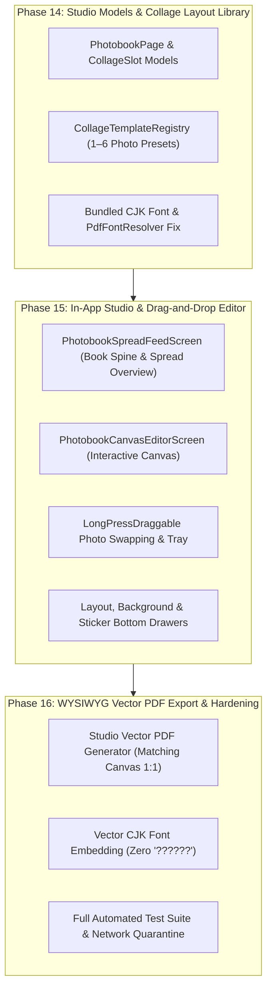

# Intermediate Milestone 3.6: DIY Photobook Studio & Interactive Scrapbook Editor (自助排版影集工作台)

## Visual Evaluation & Comparative Analysis of Uploaded Screenshots

We evaluated all 10 extracted screenshots from `images.zip` categorized into two groups:
1. **Images 1 & 2 (`com.tencent.mm` WeChat PDF Viewer)**: Real user test results of Phase 13 PDF export (`test_Square.pdf`).
2. **Images 3–10 (`com.journiapp.book` Journi Print Studio)**: Reference mobile photobook editor patterns.

---

### Group 1: PDF Export CJK Character Fallback Diagnosis (Images 1 & 2)

| Visual Finding | Technical Root Cause | Resolution Architecture |
| :--- | :--- | :--- |
| **Header Fallback**: `TRAVEL ALBUM · ???????` | `AlbumPdfExporter` defaulted to `PdfFontResolver.standard()`, which uses standard PDF Type-1 Helvetica. Standard Type-1 fonts only support 8-bit Latin-1 (codes 0–255). | Bundle an offline SIL OFL Chinese TrueType font (e.g. `Noto Serif SC` / `Kaiti SC`) in the app and load font bytes via `rootBundle.load()`. |
| **Cinnabar Seal Fallback**: `??` inside red oval seal | In `PdfFontResolver.sanitizeText()`, code points > 255 are converted to `'?'` because `isCjkCapable` defaults to `false`. | When initialized with a bundled TTF font, set `isCjkCapable: true` so Hanzi glyphs pass through to `pw.Font.ttf()` unmodified. |
| **Caption & Epilogue Fallback**: `??????????` and `MemoDiary · ????` | `AlbumPdfPreviewSheet._generateBytes()` invoked `exportAlbumPdf` without passing an instantiated `PdfFontResolver`. | Wire `PdfFontResolver.fromTtfBytes()` directly into `AlbumPdfPreviewSheet` and `AlbumPdfExporter` with zero network egress. |

---

### Group 2: DIY Photobook Studio Patterns (Images 3–10)

```
┌─────────────────────────────────────────────────────────────────────────────┐
│                       JOURNI PRINT STUDIO WORKFLOW                         │
├─────────────────────┬───────────────────────────┬───────────────────────────┤
│ 1. Book Overview    │ 2. Single Page Canvas     │ 3. Customization Drawers │
│ (Image 10)          │ (Images 3 & 4)            │ (Images 5, 6, 7, 8, 9)    │
│                     │                           │                           │
│  Facing spread feed │  Drag-and-drop slots      │  - Layout Presets (Img 5) │
│  Left & Right pages │  Tap-to-edit photo crop   │  - Color Palettes (Img 6) │
│  Page reordering    │  Removed photo tray       │  - Book Themes (Img 7)    │
│  Add / remove pages │  Spine & margin guides    │  - Text & Stickers(Img 9) │
└─────────────────────┴───────────────────────────┴───────────────────────────┘
```

#### 1. Interactive Page Canvas & Drag-and-Drop (Images 3 & 4)
- **Image 3**: Focused single-page spread ("Page 2/25"). The page renders an asymmetric 3-photo collage (1 dominant portrait on the left, 2 stacked thumbnails on the right) with a page ribbon indicator.
- **Image 4**: **Tactile Drag Gestures**: A photo slot is lifted with elevation, drop shadow, and floating state (`LongPressDraggable` / `DragTarget`), allowing the user to reposition or swap photos between collage slots in real time.
- **Bottom Tool Bar**: 4 quick-action tabs:
  - `Removed (已移出)`: Staging tray for excluded photos that can be dragged back onto the canvas.
  - `Add (添加)`: Element insertion drawer.
  - `Background (背景)`: Canvas background styling.
  - `Layout (排版)`: Collage layout picker.

#### 2. Multi-Photo Collage Layout Picker (Image 5)
- Tapping **Layout** opens a bottom drawer displaying preset layout variations tailored to the exact number of photos assigned to the page (e.g., 3 photos):
  - **Hero Left**: 1 tall dominant photo left, 2 stacked photos right.
  - **Triptych Columns**: 3 vertical columns side-by-side with header text.
  - **Stacked Banners**: 3 horizontal rows.
  - **Framed Classic**: Wide Xuan paper margins with bottom caption box.
- Selecting a preset immediately re-flows the photos without mutating image files or metadata.

#### 3. Background Colors, Paper Textures & Corner Accents (Images 6 & 8)
- **Image 6**: Color palette drawer with curated swatches and contrast text previews (`Aa`). Instant canvas background update.
- **Image 8**: Background graphic patterns & corner accents:
  - Full-bleed wallpaper patterns (traditional botanical motifs, vintage textures).
  - Delicate corner sprigs (top-right and bottom-left floral/ink accents).
  - Side decorative borders.

#### 4. Full Photobook Themes (Image 7)
- "Themes & Style" catalog: Curated global aesthetics combining color palette, typography, and graphic ornaments ("宣纸水墨", "古卷青缃", "竹林清风", "江南烟雨", "丹砂华彩").
- 1-tap "Apply" button styles the entire photobook cohesively across all pages.

#### 5. Add Elements: Text Blocks & Ephemera Stickers (Image 9)
- **Add Elements** drawer enables adding:
  - Additional photos from album collection.
  - Text blocks: Title, Date badge, Story paragraph.
  - Decorative Stickers: Cinnabar seals (印章), travel postmarks (邮戳), destination pins (路线签), weather emblems (天气签).

#### 6. Multi-Spread Overview Feed (Image 10)
- Vertical facing-spread overview (Left & Right pages with spine shadow).
- Allows reordering spreads, adding blank pages, or tapping any page to open the Canvas Editor.

---

## Architecture Plan: Intermediate Milestone 3.6 (Phases 14–16)



### Phase 14: Studio Data Model, Offline CJK Font Resolution & Collage Layout Library
1. **Studio Data Models** (`lib/features/albums/models/photobook_studio_models.dart`):
   - `PhotobookProject`: collection ID, theme ID, page format (A4 Landscape / Square), list of `PhotobookPageModel`.
   - `PhotobookPageModel`: page index, template ID, background style (color, texture, corner graphics), list of `PhotobookSlotModel` (photo ID, crop rect, caption, aspect ratio), list of `PhotobookStickerModel` (stamp type, normalized x/y, rotation, scale).
2. **Collage Template Library** (`lib/features/albums/services/photobook_layout_templates.dart`):
   - Pure Dart responsive geometry calculator defining normalized slot bounding boxes `Rect.fromLTWH(left, top, width, height)` for 1, 2, 3, 4, 5, 6 photos per page:
     - **1 Photo**: Full Bleed, Classic Polaroid, Centered Hero with extended caption.
     - **2 Photos**: Side-by-Side Split, Top/Bottom Stack, 60/40 Asymmetric Focus.
     - **3 Photos**: Hero Left + 2 Right Stack (Journi Img 3), 3-Column Triptych, 1 Top + 2 Bottom.
     - **4 Photos**: 2×2 Balanced Grid, 1 Hero + 3 Thumbnails Strip.
     - **5–6 Photos**: Mosaic Collage.
3. **Offline CJK Font Resolution Fix**:
   - Bundle an offline SIL OFL CJK font in `assets/fonts/` (or load system CJK font bytes), register in `pubspec.yaml`.
   - Update `PdfFontResolver` to cache and provide CJK fonts with `isCjkCapable: true`.
   - Ensure zero `?` glyphs in exported PDFs.

### Phase 15: Book Overview Spread Feed & Interactive Drag-and-Drop Page Editor UI
1. **Book Overview Spread Feed** (`lib/features/albums/screens/photobook_studio_screen.dart`):
   - Facing-page layout with realistic book spine crease, page numbers, and action bar (Add, Arrange, Themes, Export).
2. **Interactive Drag-and-Drop Page Editor** (`lib/features/albums/screens/photobook_page_editor_screen.dart`):
   - Interactive canvas displaying the selected `PhotobookPageModel`.
   - `LongPressDraggable` photo swapping: Drag a photo onto another slot to swap positions smoothly.
   - Removed photo drawer (`RemovedPhotosTray`) to stash and retrieve photos.
3. **Customization Drawers**:
   - **Layout Drawer**: Visual thumbnails for switching collage presets (Journi Img 5).
   - **Background Drawer**: Color swatches, paper textures, and corner border accents (Journi Img 6 & 8).
   - **Stickers & Elements Drawer**: Literati seals, cinnabar stamps, travel badges, and date pills (Journi Img 9).
   - **Theme Selector**: Literati themes (宣纸水墨, 古卷青缃, 竹林清风, etc.) (Journi Img 7).

### Phase 16: WYSIWYG Vector PDF Photobook Renderer & Hardening
1. **WYSIWYG Vector PDF Exporter** (`lib/features/albums/services/photobook_pdf_renderer.dart`):
   - Compiles custom `PhotobookProject` spreads into vector PDF pages with exact slot coordinates, background colors, decorative borders, Cinnabar seals, and CJK text.
2. **Export Preview Sheet**:
   - Updates `AlbumPdfPreviewSheet` to preview and export the user's customized DIY layouts.
3. **Verification & Hardening Suite**:
   - Unit tests for collage geometry calculations, slot swapping, and serialization.
   - Widget tests for drag-and-drop photo swaps, layout switching, and background updates.
   - PDF integration test verifying 0 font exceptions, non-empty pages, and valid CJK glyph encoding.
   - Zero-network quarantine audit pass.
