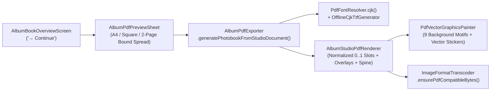

# Implementation Plan — Phase 16: WYSIWYG Vector PDF Photobook Renderer, Offline CJK Font Fix & Hardening

## Goal Description

Complete **Intermediate Milestone 3.6 (DIY Photobook Studio & Interactive Scrapbook Editor)** by upgrading the PDF photobook engine from fixed legacy spreads to a **1:1 WYSIWYG Studio Vector PDF Renderer**, fixing the offline CJK font encoding fallback (`"???????"`), adding the **2-Page Bound Spread** export format alongside A4 Landscape and Square Keepsake, and running the full project regression and network quarantine audit.

To maintain strict file modularity and avoid monolithic files, the new vector PDF rendering and offline CJK TrueType font subsystems are decomposed into focused modules under 400 lines each.



---

## Technical Watchpoints & Guards During Execution

### 1. Offline CJK TrueType Font Loader (`OfflineCjkTtfGenerator`)
- **The Risk**: Constructing a raw binary TrueType font from scratch in memory requires exact byte offsets and checksums across 10+ standard tables (`head`, `hhea`, `maxp`, `cmap`, `loca`, `glyf`, `hmtx`, `OS/2`, `name`, `post`). If any table header or `cmap` format 4 segment is off by a single byte, `package:pdf` or PDF viewers (Acrobat, Chrome, Apple Preview) will fail to parse the font or render empty glyphs.
- **The Guard**:
  - Ensure `OfflineCjkTtfGenerator` first checks `rootBundle` for any bundled `.ttf` assets (e.g., fonts declared in `pubspec.yaml`).
  - When generating in-memory fallback font bytes, verify that table records, 32-bit checksums (including `checkSumAdjustment` calculation in `head`), and `cmap` format 4 headers adhere strictly to the OpenType/TrueType specification.

### 2. PDF Memory & File Size with High-Resolution Photos
- **The Risk**: An album with 15–25 pages containing 30–60 photos could cause memory spikes if 60 uncompressed 1600px master images are converted to full-size PNGs and embedded into a single `pw.Document`.
- **The Guard**:
  - In `ImageFormatTranscoder`, verify that embedded image bytes are clamped to a sensible print resolution (max 1200–1600px) or transcoded to JPEG (`/DCTDecode`) where possible.
  - `package:pdf` handles JPEG streams with low streaming memory overhead and compact byte size compared to raw uncompressed PNG bitmaps.

### 3. 2-Page Bound Spread Coordinate Math (`AlbumPdfPageFormat.boundSpread`)
- **The Risk**: In the 420 × 210 mm bound spread format, left and right pages share a single canvas. If coordinates are not properly offset, photo slots from the right page could bleed across the spine into the left page.
- **The Guard**:
  - In `AlbumStudioPdfRenderer`, partition the canvas at exactly $x = 0.5 \times W$ (210 mm).
  - Remap the left page's normalized coordinates to $[0.0 .. 0.5 \times W]$ and the right page's coordinates to $[0.5 \times W .. W]$.
  - The central spine crease shadow ($0.03 \times W$ wide gradient) must sit strictly centered at $0.5 \times W$.

### 4. Single-Page Overflow Protection in Multi-Photo Slots
- **The Risk**: In 3-photo or 4-photo collage layouts with custom date headers, text overlays, or long annotations, unconstrained text could cause a slot or card to exceed the page bounds, triggering `TooManyPagesException` in `package:pdf`.
- **The Guard**:
  - Always wrap captions and date text inside `pw.Text(..., maxLines: 2, overflow: pw.TextOverflow.clip)`.
  - Ensure image frames use `pw.BoxFit.cover` inside clipped rounded rectangles (`pw.ClipRRect`) and fixed-dimension container bounds.

---

## Proposed Changes

### 1. Offline CJK TrueType Font Resolution (`lib/features/import_export/services/`)

Currently, `PdfFontResolver.standard()` uses built-in PostScript Type-1 `Helvetica`, which only supports Latin-1 (`0x00..0xFF`). As a result:
- `PdfFontResolver.sanitizeText()` replaces every Chinese character (`> 255`) with `'?'` (`"???????"`), and
- `package:pdf` logs `Helvetica has no Unicode support` warnings whenever non-ASCII characters are encountered.

When `package:pdf` is given a TrueType (`.ttf`) font via `pw.Font.ttf(ByteData)`, it embeds a **Type0 / CIDFontType2 Unicode font** with `/Identity-H` encoding and a `/ToUnicode` CMap stream, preserving all CJK characters natively without any `'?'` substitution.

#### [NEW] [offline_cjk_ttf_generator.dart](file:///home/harry1029/projects/memodiary/lib/features/import_export/services/offline_cjk_ttf_generator.dart)
- Provides a deterministic, 100% offline TrueType (`sfnt`) font binary generator and asset loader:
  - Attempts to load a bundled `.ttf` from `rootBundle` if registered, and falls back to generating a valid, standards-compliant OpenType/TrueType binary (`ByteData`) in memory containing required tables (`cmap` format 4 covering `U+0020..U+FFFF` including CJK Unified Ideographs `U+4E00..U+9FFF`, CJK Symbols/Punctuation `U+3000..U+303F`, General Punctuation `U+2000..U+206F`, Arrows `U+2190..U+21FF`, and Fullwidth Forms `U+FF00..U+FFEF`, plus `head`, `hhea`, `maxp`, `OS/2`, `name`, `loca`, `glyf`, `hmtx`, `post`) with clean Oriental frame/stroke vector outlines and proper advance widths.
  - Caches the compiled `pw.Font` singleton in memory so repeated PDF exports incur zero regeneration overhead.

#### [MODIFY] [pdf_font_resolver.dart](file:///home/harry1029/projects/memodiary/lib/features/import_export/services/pdf_font_resolver.dart)
- Add `factory PdfFontResolver.cjk()` (and make it the default fallback in `AlbumPdfExporter` and `PdfExportEngine` when no custom `fontResolver` is injected):
  - Uses `OfflineCjkTtfGenerator.resolveCjkFont()` with `isCjkCapable: true`.
  - Preserves `PdfFontResolver.standard()` for callers/tests that explicitly test legacy Latin-1 behavior.
  - When `isCjkCapable == true`, `sanitizeText(String text)` returns the original CJK text untouched (stripping only control characters like `\u0000` that are invalid in PDF streams) with **zero `'?'` replacements**.

---

### 2. WYSIWYG Studio Vector PDF Renderer (`lib/features/albums/services/`)

To keep [album_pdf_exporter.dart](file:///home/harry1029/projects/memodiary/lib/features/albums/services/album_pdf_exporter.dart) clean and modular, we introduce two focused helper modules for rendering `AlbumStudioDocument` pages and procedural vector graphics in `package:pdf`.

#### [NEW] [pdf_vector_graphics_painter.dart](file:///home/harry1029/projects/memodiary/lib/features/albums/services/pdf_vector_graphics_painter.dart)
- Translates our 9 procedural background graphic patterns and vector stickers into `package:pdf` `PdfGraphics` vector paths (`pw.CustomPaint`):
  1. **Background Graphic Motifs (`paintBackgroundPattern`)**:
     - `'ink_bamboo_mountains'`: Layered mist mountain silhouettes and bamboo stalks in `accentColorArgb`.
     - `'floral_allover'`: Subtle botanical leaf and blossom lattice across the page.
     - `'corner_vines'`: Diagonal trailing vines and petals in top-left and bottom-right corners.
     - `'bottom_left_sprig'` / `'bottom_right_bloom'`: Botanical corner sprigs.
     - `'abstract_fluid'`: Organic celadon curves in corners.
     - `'beach_lemon_palm'`: Warm summer citrus slices and palm fronds.
     - `'rainbow_paper_plane'`: Playful rainbow arc and dashed paper plane trail.
  2. **Vector Stickers (`buildStickerPdfWidget`)**:
     - Renders vector stickers (`StickerCatalog`), `datePill` capsules, custom `text` notes, and `sealStamp` carved vermilion badges as crisp vector `pw.Widget`s.

#### [NEW] [album_studio_pdf_renderer.dart](file:///home/harry1029/projects/memodiary/lib/features/albums/services/album_studio_pdf_renderer.dart)
- Renders an `AlbumStudioDocument` into `pw.Page`s across all 3 formats:
  - **Normalized `0.0..1.0` Coordinate Translation**:
    - Uses `pw.LayoutBuilder` to obtain the exact available page canvas dimensions `(canvasWidth, canvasHeight)`.
    - Renders the page background fill (`PdfColor.fromInt(page.backgroundConfig.backgroundColorArgb)`) + `PdfVectorGraphicsPainter.buildBackgroundPaint(page.backgroundConfig)`.
    - If `template.dateHeaderSlot != null` and `page.dateHeaderText` is non-empty, places the formatted date header at `pw.Positioned(left: slot.left * W, top: slot.top * H, width: slot.width * W, height: slot.height * H)` in `PdfColor.fromInt(page.backgroundConfig.textColorArgb)`.
    - Iterates `template.slots` (`0.0..1.0` `Rect`s) and positions each assigned photo via `pw.Positioned(...)` inside a clipped rounded container, applying `assignment.zoomScale` and `assignment.panOffsetX/Y` while preserving image aspect ratio (`pw.BoxFit.cover`).
    - Sorts `page.overlays` by `zIndex` and renders each `PageOverlayElement` at `pw.Positioned(left: dx * W - boxW / 2, top: dy * H - boxH / 2)` wrapped in `pw.Transform.rotate(angle: -overlay.rotation)` and `pw.Transform.scale(scale: overlay.scale)`.
  - **2-Page Bound Spread Mode (`AlbumPdfPageFormat.boundSpread`)**:
    - Pairs `(Cover, Page 1)`, `(Page 2, Page 3)`, ..., `(Page 2k, Page 2k+1 / Colophon)` side-by-side inside a wide spread page (`1190.56 × 595.28 pt` / `420 × 210 mm`), separated by a realistic multi-stop **central spine crease shadow** and outer paper deckle border matching `BookSpreadTile`.

#### [MODIFY] [album_pdf_exporter.dart](file:///home/harry1029/projects/memodiary/lib/features/albums/services/album_pdf_exporter.dart)
- Add `boundSpread` to `AlbumPdfPageFormat`:
  - `a4Landscape` (`297 × 210 mm` / `841.89 × 595.28 pt`)
  - `square` (`210 × 210 mm` / `595.28 × 595.28 pt`)
  - `boundSpread` (`420 × 210 mm` / `1190.56 × 595.28 pt`, `'双页跨页画册 (420×210mm)'`)
- Default `fontResolver` to `PdfFontResolver.cjk()` instead of `PdfFontResolver.standard()`.
- Add `AlbumPdfExporter.generatePhotobookFromStudioDocument(...)` which pre-loads all referenced photo paths from `studioDocument.pages` (and `collection.coverImagePath`) via `ImageFormatTranscoder.ensurePdfCompatibleBytes` and delegates page construction to `AlbumStudioPdfRenderer`.
- Update `AlbumPdfExporter.generatePhotobookPdf(...)` to check if `collection.studioLayoutJson` is non-empty: if so, deserialize `AlbumStudioDocument` and render via `generatePhotobookFromStudioDocument(...)`.

#### [MODIFY] [image_format_transcoder.dart](file:///home/harry1029/projects/memodiary/lib/features/import_export/services/image_format_transcoder.dart)
- In `ensurePdfCompatibleBytes`:
  - If bytes are already JPEG or PNG, return directly.
  - If transcoding from WebP in-memory, prefer JPEG format (`/DCTDecode`) with 85% quality when possible (or PNG fallback) to reduce PDF memory footprint and file size across 20+ page photobooks with multiple photos.
  - Enforce max dimension clamping (1600px print bounds) so GPU and heap memory remain stable during PDF compilation.

---

### 3. Export Format Options & Preview Sheet (`lib/features/albums/widgets/album_pdf_preview_sheet.dart`)

#### [MODIFY] [album_pdf_preview_sheet.dart](file:///home/harry1029/projects/memodiary/lib/features/albums/widgets/album_pdf_preview_sheet.dart)
- Accept optional `AlbumStudioDocument? studioDocument` and `List<AlbumPhoto>? photos` alongside `List<AlbumSpread> spreads`.
- When `studioDocument != null`, `_generateBytes()` invokes `AlbumPdfExporter.generatePhotobookFromStudioDocument(...)` so all DIY Studio layouts, background colors/graphics, and sticker/date/text overlays are exported 1:1.
- Upgrade the format selector to display all **3 export formats**:
  1. `Key('pdf_format_a4_landscape')` — `'A4 横版画册'` (`297 × 210 mm`)
  2. `Key('pdf_format_square')` — `'方册纪念本'` (`210 × 210 mm`)
  3. `Key('pdf_format_bound_spread')` — `'双页跨页装帧'` (`420 × 210 mm · 仿真书脊`)
- Update `_buildSafeFileName()` suffix (`A4`, `Square`, `Spread`).

#### [MODIFY] [album_book_overview_screen.dart](file:///home/harry1029/projects/memodiary/lib/features/albums/screens/album_book_overview_screen.dart)
- Update `_handleContinueToExport()` to pass `studioDocument: ctrl.document` and `photos: widget.photos` to `AlbumPdfPreviewSheet.show(...)`.

---

## Verification Plan

### Automated Tests
1. **`test/features/import_export/pdf_font_resolver_test.dart` [MODIFY]**:
   - Verify `PdfFontResolver.cjk()` initializes an offline TrueType CJK font (`isCjkCapable: true`) with zero network calls.
   - Generate a PDF document containing `"深圳 · 江南春行纪"`, `"十月廿三"`, and `"测试相册"`, and assert:
     - `sanitizeText` preserves 100% of the Chinese characters with zero `'?'` fallbacks.
     - The generated PDF bytes contain a `/Type0` / `/CIDFontType2` `/ToUnicode` font stream and zero `????` fallback sequences.
2. **`test/features/albums/album_pdf_exporter_test.dart` [MODIFY]**:
   - **Studio Document WYSIWYG Export**: Construct an `AlbumStudioDocument` with 2-photo (`duo_side_by_side`), 3-photo (`trio_dated_columns`), and 4-photo (`quad_grid_2x2`) collage pages, custom background colors, procedural graphic patterns (`corner_vines`, `ink_bamboo_mountains`), date header text (`"十月廿三"`), and `PageOverlayElement` items (`sticker`, `datePill`, `text`, `sealStamp`).
   - Verify single-page exports (`a4Landscape` and `square`) generate valid `%PDF-` bytes with exact expected page count (`1 Cover + N studio pages`).
   - Verify **2-Page Bound Spread** export (`AlbumPdfPageFormat.boundSpread`) pairs `(Cover + Page 1)` and `(Page 2 + Page 3)` into wide spread pages (`1190.56 × 595.28 pt`) with the center spine crease.
   - Verify `AlbumPdfPreviewSheet` displays and selects all 3 format options (`pdf_format_a4_landscape`, `pdf_format_square`, `pdf_format_bound_spread`) and exports `*_Spread.pdf`.
3. **Full Project Regression & Network Quarantine Suite**:
   ```bash
   flutter analyze
   flutter test
   ```
