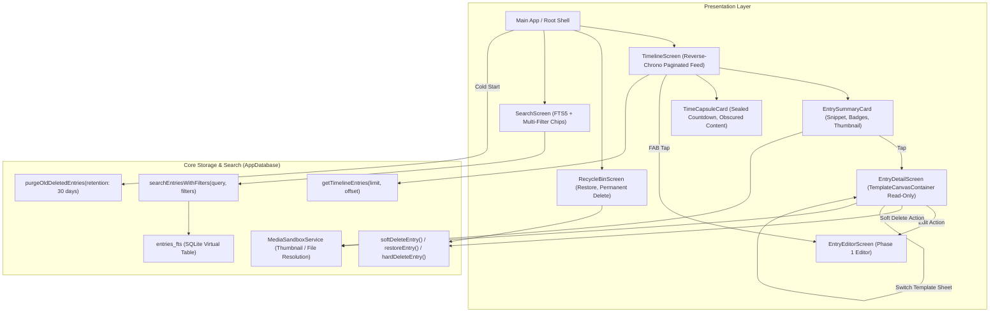

# Implementation Plan — Phase 2: High-Speed Timeline, CRUD & Offline FTS5 Search

Following the completion of **Phase 0** (Encrypted Drift SQLCipher Database, Media Sandbox, App Lock Gate) and **Phase 1** (Procedural Canvas Templates, Rich-Text Quill Editor, Offline Typography, Voice Dictation), **Phase 2** builds the browsing, reading, lifecycle management, and retrieval engine for MemoDiary.

---

## User Review Required

> [!IMPORTANT]
> **1. Time Capsule Content Privacy Invariant**
> If an entry has an `unlockAt` timestamp where `DateTime.now().isBefore(unlockAt)`, the timeline and search interfaces must **strictly conceal** its plain text snippet, Quill Delta, and media thumbnails. Only the title (or "Time Capsule"), countdown status, and unlock date are visible until the epoch arrives.

> [!IMPORTANT]
> **2. 30-Day Recycle Bin Auto-Purge Lifecycle**
> Soft-deleted entries (`isDeleted = true`) remain recoverable for 30 days. On application cold start, a background auto-purge routine permanently deletes entries with `updatedAt < DateTime.now().subtract(Duration(days: 30))`, simultaneously removing linked media files in `mediaSandboxService` to reclaim device storage.

> [!NOTE]
> **3. Multi-Condition FTS5 Search Architecture**
> SQLite FTS5 indexes `title` and `plain_text`. Our search query combines the FTS5 virtual table MATCH query with relational filters (`mood`, `weather`, `entry_date` range, `hasImage`, `is_weekly_review`) in a single SQLite query for sub-10ms response times.

---

## Architecture Overview



---

## Proposed Changes

Grouped by component layer:

### 1. Dependencies (`pubspec.yaml`)

Add `share_plus` (BSD-3-Clause) for sharing diary entries:
- `share_plus: ^12.0.2`

#### [MODIFY] `pubspec.yaml`
- Add `share_plus: ^12.0.2` under `dependencies`.

---

### 2. Database Layer Extensions (`lib/core/database/app_database.dart`)

Implement high-speed pagination, CRUD lifecycle, media resolution, and multi-filter FTS5 search queries.

#### [MODIFY] `lib/core/database/app_database.dart`
- Add queries:
  - `getTimelineEntries({int limit = 20, int offset = 0})`:
    Fetches non-deleted entries ordered by `entryDate DESC` with pagination.
  - `getEntryWithMedia(String id)`:
    Fetches entry and its linked media attachments.
  - `getPrimaryMediaForEntries(List<String> entryIds)`:
    Batch-retrieves first media attachment for each entry in timeline feed.
  - `softDeleteEntry(String id)`:
    Sets `isDeleted = true` and updates `updatedAt = DateTime.now()`.
  - `restoreEntry(String id)`:
    Sets `isDeleted = false` and updates `updatedAt = DateTime.now()`.
  - `hardDeleteEntry(String id)`:
    Permanently deletes entry and linked `media_attachments` records.
  - `getDeletedEntries()`:
    Fetches soft-deleted entries ordered by `updatedAt DESC`.
  - `purgeOldDeletedEntries({Duration retention = const Duration(days: 30)})`:
    Permanently removes records soft-deleted >30 days ago.
  - `searchEntriesWithFilters(...)`:
    Executes SQLite FTS5 search combined with relational filter predicates.

---

### 3. Timeline Feed (`lib/features/timeline/`)

#### [NEW] `lib/features/timeline/models/timeline_entry_item.dart`
- Compound model packaging `Entry` with its primary thumbnail `MediaAttachment?` and time capsule status.

#### [NEW] `lib/features/timeline/widgets/entry_summary_card.dart`
- Timeline card for standard entries and unlocked time capsules:
  - Header: Formatted date (e.g. "Oct 16, 2026", weekday), mood emoji badge, weather badge.
  - Title and 2-line plain text snippet.
  - Weekly review ribbon/badge if `isWeeklyReview == true`.
  - Rounded thumbnail on right if image attachment exists (resolved via `MediaSandboxService`).
  - Tap navigates to `EntryDetailScreen`.

#### [NEW] `lib/features/timeline/widgets/time_capsule_card.dart`
- Sealed time capsule card for entries where `DateTime.now().isBefore(unlockAt)`:
  - Distinct purple/indigo card background with padlock icon.
  - Conceals all text snippets and media attachments.
  - Live countdown pill: "Sealed · Unlocks in X days" and target unlock date.
  - Tapping displays an encouraging dialog explaining the capsule is sealed until the unlock date.

#### [NEW] `lib/features/timeline/screens/timeline_screen.dart`
- Main screen with lazy pagination:
  - `ListView.builder` with `ScrollController` threshold triggering next page fetch.
  - Empty state with friendly illustration and "Write your first entry" action.
  - Search icon in AppBar navigating to `SearchScreen`.
  - Recycle bin navigation in drawer or AppBar action.
  - Extended FAB ("Write Diary") generating a new entry and navigating to `EntryEditorScreen`.

---

### 4. Template-Accurate Detail Reader Screen (`lib/features/timeline/screens/entry_detail_screen.dart`)

#### [NEW] `lib/features/timeline/screens/entry_detail_screen.dart`
- Full-screen read-only viewer:
  - Renders entry inside `TemplateCanvasContainer` with the entry's active `TemplateStyle`.
  - `QuillEditor` in `readOnly: true` mode with `SandboxedImageEmbedBuilder` and full typography.
  - Header with entry date, mood, weather, and time capsule tags.
  - Bottom action bar:
    - **Edit**: Jumps into `EntryEditorScreen`.
    - **Template**: Opens `TemplateSwitcherSheet` to swap styling on the fly.
    - **Share**: Exports entry title and plain text via `Share.share()`.
    - **Delete**: Prompts confirmation to move entry to Recycle Bin (`softDeleteEntry`).

---

### 5. 30-Day Recycle Bin (`lib/features/recycle_bin/`)

#### [NEW] `lib/features/recycle_bin/screens/recycle_bin_screen.dart`
- Lists all entries where `isDeleted == true`:
  - Card displays title, deletion date, and "Purges in X days" countdown badge.
  - Actions:
    - **Restore** (↺): Restores entry back to timeline.
    - **Delete Forever** (🗑️): Permanently deletes database record and cleans up media sandbox files.
  - Top action "Empty Trash" to purge all deleted entries immediately with confirmation.

#### [NEW] `lib/core/services/recycle_bin_service.dart`
- Manages purge lifecycle and physical media file deletion upon permanent deletion.
- Auto-purge runner executed on app startup.

---

### 6. Offline Full-Text Search & Multi-Filter (`lib/features/search/`)

#### [NEW] `lib/features/search/models/search_filters.dart`
- Filter criteria model:
  - `DateRangeFilter dateRange`: `all`, `thisWeek`, `thisMonth`, `custom(start, end)`
  - `int? mood`: Filter by mood 1–5
  - `String? weather`: Filter by weather
  - `bool hasImage`: Filter entries containing photos
  - `bool weeklyReviewOnly`: Filter weekly review entries

#### [NEW] `lib/features/search/widgets/search_filter_chips.dart`
- Horizontal scrollable filter chips allowing users to toggle date range, mood, weather, and flags.

#### [NEW] `lib/features/search/screens/search_screen.dart`
- Real-time search screen:
  - Search input with 300ms debounce.
  - Filter chips row.
  - Results feed displaying matching entries with highlighted search snippets.
  - One-tap navigation to `EntryDetailScreen`.
  - Empty state when no matches found.

---

### 7. App Shell & Startup Integration (`lib/main.dart`)

#### [MODIFY] `lib/main.dart`
- Replace boilerplate `MyHomePage` with `TimelineScreen` as the app home.
- Trigger `RecycleBinService.purgeExpiredEntries(database, mediaSandboxService)` on launch.

---

## Verification Plan

### Automated Tests
Run comprehensive test suite across timeline, reader, recycle bin, and search:
```bash
# 1. Update dependencies
flutter pub get

# 2. Build runner (if database queries change)
flutter pub run build_runner build --delete-conflicting-outputs

# 3. Static analysis
flutter analyze

# 4. Run all test suites
flutter test
```

### Specific Test Suites to Add:
1. **`test/features/timeline/timeline_repository_test.dart`**:
   - Verify pagination (page size, limit, offset, ordered by `entryDate DESC`).
   - Verify soft-deleted entries are completely excluded from timeline queries.
   - Verify Time Capsule status check (sealed vs unlocked).
2. **`test/features/recycle_bin/recycle_bin_test.dart`**:
   - Verify `softDeleteEntry` flags `isDeleted = true`.
   - Verify `restoreEntry` resets `isDeleted = false`.
   - Verify `hardDeleteEntry` deletes entry and associated media attachments.
   - Verify `purgeOldDeletedEntries` removes records older than 30 days while retaining recent soft-deletions.
3. **`test/features/search/search_filter_test.dart`**:
   - Test FTS5 search query matching `title` and `plainText`.
   - Test multi-condition filters: date range, mood, weather, hasImage, weeklyReview.
   - Test combining FTS5 keyword with filters.
4. **`test/features/timeline/entry_detail_screen_test.dart`**:
   - Widget test verifying detail screen renders `TemplateCanvasContainer`, read-only `QuillEditor`, and action buttons (Edit, Template, Share, Delete).
5. **`test/features/timeline/timeline_screen_test.dart`**:
   - Widget test verifying timeline feed displays normal cards and sealed Time Capsule cards.
   - Test FAB initiates draft creation and navigation.
