# Implementation Plan — Phase 3: Smart Batch Ingestion & Data Portability

Following **Phase 0** (Security & Database), **Phase 1** (Procedural Templates & Multimodal Editor), and **Phase 2** (Timeline, CRUD & FTS5 Search), **Phase 3** delivers large-file diary ingestion with intelligent date parsing, interactive import staging, versatile Markdown/YAML export, storage analysis, orphan media optimization, and privacy dashboards.

---

## User Review Required

> [!IMPORTANT]
> **1. Background Isolate Parsing for 60 FPS Invariant**
> Parsing massive `.txt` and `.md` diary backup files (potentially hundreds of kilobytes or megabytes containing years of entries) involves multiple regex sweeps and text splitting. All parsing and regex evaluation will execute strictly inside a background `Isolate` worker via `Isolate.run()` or `compute()` so the main UI thread never drops frames.

> [!IMPORTANT]
> **2. Atomic Database Rollback on Corrupted Import**
> Batch importing candidate entries runs inside an atomic SQLite transaction (`database.transaction()`). If any entry insertion fails, the entire batch rolls back cleanly without leaving partial or corrupted records in SQLite or the FTS5 index.

> [!NOTE]
> **3. Storage Optimization & Orphan Media Cleaner**
> Media attachments in MemoDiary are sandboxed (`media/{uuid}.webp`). When drafts are discarded or imports are cancelled, unlinked media files may linger. The Storage Optimizer inspects the physical sandbox directory against active records in `media_attachments` and safely purges unreferenced files with one tap.

---

## Architecture Overview

```mermaid
flowchart TD
    subgraph ImportPipeline ["Import & Date Ingestion Pipeline"]
        TxtMdFile[".txt / .md Diary File"] --> FilePicker["file_picker (Single/Multi-file)"]
        FilePicker --> IsolateWorker["Isolate.run(DateParserEngine.parseDocument)"]
        
        subgraph RegexEngine ["Ordered Regex & Context Parser"]
            ISO["1. ISO Patterns (YYYY-MM-DD)"]
            Chinese["2. Chinese Patterns (YYYY年MM月DD日)"]
            Western["3. Western Patterns (Month Day, Year)"]
            Relative["4. Relative Markers (昨天, 上周六)"]
        end
        
        IsolateWorker --> RegexEngine
        RegexEngine --> Splitter["Document Section Splitter"]
        Splitter --> StagingScreen["ImportStagingScreen (Interactive Review)"]
        StagingScreen -->|Manual Date Fix & Filter| BatchedTx["AppDatabase.batchImportEntries() (Atomic Tx)"]
        BatchedTx --> SQLiteDB["SQLite & FTS5 Index"]
    end

    subgraph ExportPipeline ["Data Portability & Export Pipeline"]
        EntriesDB["AppDatabase Entries"] --> ExportEngine["ExportService"]
        ExportEngine --> MarkdownSerializer["Markdown + YAML Frontmatter"]
        ExportEngine --> TextSerializer["Formatted Plain Text"]
        MarkdownSerializer --> LocalDisk["Direct Local Storage / Share"]
        TextSerializer --> LocalDisk
    end

    subgraph SettingsAndStorage ["Settings & Storage Optimizer"]
        SettingsScreen["SettingsScreen"]
        PermDash["Permission Dashboard (Camera, Mic, Storage)"]
        StorageAnalyzer["Storage Analyzer (DB Size, Media Size, Trash)"]
        OrphanCleaner["Orphan Media Cleaner (Sandbox Scan vs SQLite)"]
        PrivacyCard["100% Offline Zero-Cloud Declaration"]
        
        SettingsScreen --> PermDash
        SettingsScreen --> StorageAnalyzer
        SettingsScreen --> OrphanCleaner
        SettingsScreen --> PrivacyCard
    end
```



---

## Proposed Changes

### 1. Dependencies (`pubspec.yaml`)

#### [MODIFY] `pubspec.yaml`
- Add `file_picker: ^11.0.3` for cross-platform local file selection (`.txt`, `.md`).

---

### 2. Regex & Contextual Date Parser Engine (`lib/features/import_export/services/`)

#### [NEW] `lib/features/import_export/models/import_candidate_entry.dart`
- Model representing an imported entry candidate:
  - `String id`: Unique identifier
  - `DateTime? parsedDate`: Detected or manually assigned timestamp
  - `String title`: Extracted heading or generated snippet
  - `String plainText`: Body text
  - `String contentDelta`: Delta JSON formatted for Quill
  - `DateParseConfidence confidence`: `high`, `medium`, `low`, `none`
  - `bool isSelected`: Whether included in final commit
  - `int? mood`: Detected mood if any
  - `String? weather`: Detected weather if any

#### [NEW] `lib/features/import_export/services/date_parser_engine.dart`
- Multi-tier date detection regex suite:
  1. **ISO 8601 & Numeric**:
     - `YYYY-MM-DD`, `YYYY/MM/DD`, `YYYY.MM.DD` with optional `HH:mm[:ss]`
  2. **Chinese Formats**:
     - `YYYY年MM月DD日 [HH:mm]`
     - `MM月DD日 [星期X/周X]` (year inferred from reference date or previous entry)
  3. **Western Formats**:
     - `Month Day, Year` (e.g. `October 16, 2026`, `16th Oct 2026`)
     - `MM/DD/YYYY`, `DD/MM/YYYY`
  4. **Relative Markers**:
     - `今天`, `昨天`, `前天`, `大前天`, `上周六`, `本周一` (resolved relative to file date/reference date)
- **Document Splitter**:
  - Scans document lines to find date anchors.
  - Splits document into discrete candidate entries.
  - Wraps execution in `Isolate.run()` to guarantee 60 FPS UI performance.

---

### 3. Interactive Import Staging Screen (`lib/features/import_export/screens/`)

#### [NEW] `lib/features/import_export/screens/import_staging_screen.dart`
- Review interface for ingested candidates:
  - Header statistics: Total parsed, high confidence count, needs review count.
  - Batch select/deselect toggle.
  - Per-entry card:
    - Checkbox selection.
    - Confidence badge (High = Green, Medium = Amber, Low/None = Red).
    - Inline Date/Time picker: Tap to re-assign or supply missing date.
    - Title and text preview.
  - Bottom action: "Import Selected (N)".
  - Atomic execution via `AppDatabase.batchImportEntries()`.
  - Result summary dialog showing imported count and error breakdown if any.

---

### 4. Single & Batch Export Engine (`lib/features/import_export/services/`)

#### [NEW] `lib/features/import_export/services/export_service.dart`
- **Markdown Serialization with YAML Frontmatter**:
  ```markdown
  ---
  id: 019273c5-9b34-782a-a9a8-e1a53b5c7777
  title: "Trip to Kyoto"
  date: 2026-10-16T14:30:00.000Z
  mood: 5
  weather: sunny
  is_weekly_review: false
  week_number: null
  ---

  # Trip to Kyoto
  
  Walking through the bamboo grove...
  ```
- **Plain Text Serialization**:
  - Clean chronological text format with headers and date stamps.
- **Export Destination**:
  - Saves directly to local storage via `path_provider` / `file_picker.saveFile()` or shares via `SharePlus`.

#### [NEW] `lib/features/import_export/widgets/export_dialog.dart`
- Modal dialog allowing user to select:
  - Format: `Markdown (.md with Frontmatter)` or `Plain Text (.txt)`
  - Scope: Single Entry, Date Range, or All Entries
  - Completes export workflow in <= 3 user taps.

---

### 5. Settings, Permissions & Storage Optimizer (`lib/features/settings/`)

#### [NEW] `lib/features/settings/screens/settings_screen.dart`
- Settings hub accessible from `TimelineScreen` AppBar.
- Four core modules:
  1. **Permission Status Dashboard**:
     - Visual statuses for Camera, Microphone, and Storage (`permission_handler`).
     - Educational disclosure of why each permission is needed and zero-cloud commitment.
  2. **Storage Analyzer**:
     - Displays database file size, media sandbox folder size, and soft-deleted trash size.
  3. **One-Tap Orphan Media Cleaner**:
     - Queries physical files in sandbox `media/` directory.
     - Compares against `media_attachments` SQLite records.
     - Identifies unreferenced files and permanently deletes them with user confirmation.
  4. **Data Portability**:
     - Quick buttons for "Import Diaries (.txt, .md)" and "Export All Diaries".
  5. **100% Offline Privacy Declaration**:
     - Verification badge confirming zero cloud telemetry, local hardware encryption, and zero third-party tracking.

#### [NEW] `lib/features/settings/services/storage_optimizer_service.dart`
- Calculates disk usage statistics for DB and sandbox media.
- Implements orphan media scanning and purging logic.

#### [MODIFY] `lib/core/database/app_database.dart`
- Add `batchImportEntries(List<ImportCandidateEntry> candidates)` executing atomic batch insertion within a transaction.
- Add `getAllMediaRelativePaths()` for orphan media comparison.

#### [MODIFY] `lib/features/timeline/screens/timeline_screen.dart`
- Add Settings icon button in AppBar navigating to `SettingsScreen`.
- Add "Import File" shortcut in AppBar or Drawer.

---

## Verification Plan

### Automated Tests
Run comprehensive test suites for Phase 3:
```bash
# 1. Add file_picker and update dependencies
flutter pub get

# 2. Re-run build_runner if database methods modified
flutter pub run build_runner build --delete-conflicting-outputs

# 3. Static analysis (0 issues required)
flutter analyze

# 4. Run all unit and integration tests
flutter test
```

### Specific Test Suites to Create:
1. **`test/features/import_export/date_parser_engine_test.dart`**:
   - Verify ISO date patterns (`YYYY-MM-DD`, `YYYY/MM/DD`, with time).
   - Verify Chinese date patterns (`YYYY年MM月DD日`, `MM月DD日 星期X`).
   - Verify Western date patterns (`Month Day, Year`, `DD/MM/YYYY`).
   - Verify Relative date markers (`昨天`, `前天`, `今天`, `上周六`).
   - Verify multi-entry document splitting based on date anchors.
   - Verify low confidence detection for ambiguous dates.
2. **`test/features/import_export/import_staging_and_db_test.dart`**:
   - Test atomic batched insertion in SQLite.
   - Test transaction rollback on simulated database constraint failure.
3. **`test/features/import_export/export_service_test.dart`**:
   - Verify Markdown serialization with valid YAML frontmatter.
   - Verify Plain text serialization format.
   - Verify batch export bundling.
4. **`test/features/settings/storage_optimizer_test.dart`**:
   - Verify orphan media file detection (unreferenced in `media_attachments`).
   - Verify orphan cleanup deletes only unreferenced files and retains active media.
5. **`test/features/settings/settings_screen_test.dart`**:
   - Widget test verifying permissions dashboard, storage statistics, and privacy card rendering.
