# Implementation Plan — Phase 4: Alpha QA, Benchmarking & Hardening

Following **Phase 0** (Security & Database), **Phase 1** (Procedural Templates & Multimodal Editor), **Phase 2** (Timeline, CRUD & FTS5 Search), and **Phase 3** (Batch Ingestion & Data Portability), **Phase 4** delivers the final verification suite for MemoDiary (拾光日记). This phase stress-tests database scale, guarantees crash and corruption resilience, validates offline security and zero-cloud isolation, and verifies release readiness.

---

## User Review Required

> [!IMPORTANT]
> **1. Performance Invariants Under Scale (10,000 Entries)**
> The database scale benchmark seeds 10,000 synthetic entries with active FTS5 indexing. We strictly assert:
> - Reverse-chronological timeline pagination query execution time is $\le 50\text{ms}$.
> - SQLite FTS5 search query latency is $\le 500\text{ms}$.
>
> To keep the test suite fast while evaluating realistic production loads, we seed records in chunks inside batched transactions.

> [!IMPORTANT]
> **2. Ingestion Accuracy & Latency Bar (200 Entries)**
> The ingestion benchmark feeds a 200-entry document containing mixed ISO, Chinese, Western, and relative date markers into `DateParserEngine`. We assert:
> - Execution time is $\le 10$ seconds.
> - Date recognition accuracy is $\ge 95\%$ (at least 190 / 200 correctly identified).

> [!NOTE]
> **3. Privacy & Network Quarantine Verification**
> MemoDiary commits to a $0 backend and 100% offline architecture. We verify:
> - `android.permission.INTERNET` is completely absent from `AndroidManifest.xml`.
> - Raw database bytes on disk do NOT start with plaintext `"SQLite format 3"`.
> - A strict `HttpOverrides` firewall validates that runtime code makes zero HTTP/WebSocket calls.

---

## Proposed Changes

```mermaid
flowchart TD
    subgraph Benchmarks ["1. Performance & Scale Benchmarking Suite (test/benchmarks/)"]
        DBScale["database_scale_benchmark_test.dart"]
        IngestBench["ingestion_benchmark_test.dart"]
        
        DBScale -->|10,000 Entries Seed| PaginationCheck["Assert Pagination <= 50ms"]
        DBScale -->|FTS5 Match Query| FTSLatencyCheck["Assert FTS5 <= 500ms"]
        
        IngestBench -->|200-Entry Document| IngestTimeCheck["Assert Parsing <= 10s"]
        IngestBench -->|Date Precision| IngestAccCheck["Assert Accuracy >= 95%"]
    end

    subgraph Hardening ["2. Fault-Tolerance & Integrity (test/hardening/)"]
        CorruptImport["corrupted_import_resilience_test.dart"]
        AutosaveRecovery["autosave_crash_recovery_test.dart"]
        LosslessSwitch["lossless_template_switching_stress_test.dart"]
        
        CorruptImport -->|Corrupt/Binary Ingestion| RollbackCheck["Atomic Rollback (0 Corrupt Entries)"]
        AutosaveRecovery -->|Simulated Abrupt Kill| BufferCheck["Dirty Draft Restored From SQLite"]
        LosslessSwitch -->|100 Cycles x 4 Templates| IntegrityCheck["contentDelta & Media 100% Identical"]
    end

    subgraph Security ["3. Privacy & Offline Security Audit (test/hardening/)"]
        EncAudit["database_encryption_audit_test.dart"]
        NetAudit["network_quarantine_audit_test.dart"]
        
        EncAudit -->|Header Inspection| CipherCheck["Raw File is Ciphertext (No SQLite Header)"]
        EncAudit -->|No Key / Wrong Key| FailOpenCheck["Rejects Access Without 256-bit Key"]
        NetAudit -->|HttpOverrides Firewall| ZeroNetCheck["Zero HTTP/WebSocket Calls"]
        NetAudit -->|Dependency Scan| FOSSCheck["Zero Tracking/Telemetry SDKs"]
    end

    subgraph Release ["4. Release Build Verification"]
        ManifestAudit["Manifest & Info.plist Audit"]
        StaticAnalysis["flutter analyze (0 issues)"]
        FullSuite["flutter test (100% pass across Phases 0-4)"]
    end
```



---

### 1. Performance & Scale Benchmarking Suite (`test/benchmarks/`)

#### [NEW] `test/benchmarks/database_scale_benchmark_test.dart`
- Seeds 10,000 realistic synthetic entries into `AppDatabase` across a 5-year chronological span.
- Entries contain titles, formatted Quill Delta content, segmented Chinese/English plain text, tags, moods, weather, and Time Capsule unlock dates.
- Benchmark Metrics & Assertions:
  - **Timeline Pagination**: Measures `getTimelineEntries(limit: 20, offset: 5000)` execution time using `Stopwatch`.
    - **Assertion**: Execution time $\le 50\text{ms}$.
  - **FTS5 Search Latency**: Measures `searchEntriesWithFilters(query: 'Kyoto')` across 10,000 entries.
    - **Assertion**: Query latency $\le 500\text{ms}$.
    - **Integrity**: Verifies search returns exact matched subset ordered chronologically.

#### [NEW] `test/benchmarks/ingestion_benchmark_test.dart`
- Constructs a 200-entry synthetic benchmark document representing years of diary backups.
- Includes balanced distributions of:
  - ISO numeric dates (`2026-05-12 14:30`)
  - Chinese date expressions (`2025年8月19日 星期二 晴`)
  - Western date styles (`October 16, 2024`)
  - Relative date markers (`昨天`, `前天`, `今天`)
  - Markdown headings (`# 2024-03-15`, `## 2023年12月25日`)
- Benchmark Metrics & Assertions:
  - **Total Parse Duration**: Measures `DateParserEngine.parseDocument()` runtime.
    - **Assertion**: Execution time $\le 10$ seconds.
  - **Date Recognition Precision**: Evaluates `parsedDate != null` and `confidence != DateParseConfidence.none`.
    - **Assertion**: Recognition accuracy $\ge 95\%$ (at least 190 / 200 entries accurately resolved).

---

### 2. Fault-Tolerance & Integrity Verification (`test/hardening/`)

#### [NEW] `test/hardening/corrupted_import_resilience_test.dart`
- Tests system behavior when importing malformed, truncated, or binary data:
  1. **Binary Gibberish**: Ingesting files with null bytes, PNG/ZIP magic headers, or invalid UTF-8 sequences.
  2. **Transactional Atomic Rollback**: Simulates a batch import where a failure occurs mid-batch (e.g. database constraint violation).
  3. **Verification**: Asserts that `AppDatabase` rolls back atomically:
     - SQLite `entries` table remains unchanged.
     - SQLite `entries_fts` index remains completely synchronized without orphaned search tokens.

#### [NEW] `test/hardening/autosave_crash_recovery_test.dart`
- Verifies dirty draft survival across abrupt termination:
  1. Initializes `EditorAutosaveManager` connected to a live `QuillController` and `AppDatabase`.
  2. Simulates user typing rich-text diary entries.
  3. Triggers autosave debounce/periodic cycle and simulates sudden app shutdown/crash without clean exit.
  4. Reloads entry from `AppDatabase.getEntryById(entryId)`.
  5. **Verification**: Asserts that recovered `contentDelta` and `plainText` exactly preserve uncommitted typing.

#### [NEW] `test/hardening/lossless_template_switching_stress_test.dart`
- Tests template decoupling invariant under heavy stress:
  1. Seeds an entry with complex rich-text (headers, bold/italic, bullet lists, blockquotes) and multiple sandboxed WebP image attachments (`media/{uuid}.webp`).
  2. Records deep snapshot hashes of `contentDelta`, `plainText`, title, and media attachment records.
  3. Cycles through 100 consecutive template switches across all 4 seeded templates:
     - `template_minimalist_white`
     - `template_lined_paper`
     - `template_retro_kraft`
     - `template_weekly_review`
  4. **Verification**: Asserts that after 100 switches:
     - `contentDelta` JSON string is 100% byte-for-byte identical to the original snapshot.
     - `plainText` is 100% byte-for-byte identical.
     - Linked `media_attachments` records in SQLite remain untouched.
     - Only `templateId` and `updatedAt` are modified.

---

### 3. Privacy & Offline Security Audit (`test/hardening/`)

#### [NEW] `test/hardening/database_encryption_audit_test.dart`
- Verifies on-disk database encryption with SQLCipher AES-256:
  1. Creates an encrypted database on disk via `AppDatabase.encrypted(dbFile: file, encryptionKey: key)`.
  2. Seeds notebooks, templates, entries, and FTS virtual table records.
  3. Closes the database and inspects raw binary bytes of the file:
     - **Assertion**: First 16 bytes do NOT contain standard SQLite header `SQLite format 3\000` (`0x53514C69746520666F726D6174203300`).
     - **Assertion**: Binary content is pseudo-random ciphertext.
  4. Attempts to open the file with an invalid key / raw SQLite without key:
     - **Assertion**: Opening or querying tables fails with a database encryption exception.
  5. Re-opens with the correct 256-bit key:
     - **Assertion**: Data is 100% intact and decryptable.

#### [NEW] `test/hardening/network_quarantine_audit_test.dart`
- Verifies complete zero-cloud network isolation:
  1. Installs a global `HttpOverrides` firewall that throws `StateError` on any outbound socket/HTTP request.
  2. Executes end-to-end user workflows:
     - Diary drafting & autosaving.
     - Image sandboxing & WebP compression.
     - Full-text search & filtering.
     - Markdown & plain text export.
     - Orphan media cleanup.
  3. **Assertion**: Zero outbound network requests attempted.
  4. Automated manifest & dependency audit:
     - Confirms `android.permission.INTERNET` is absent from `android/app/src/main/AndroidManifest.xml`.
     - Confirms no cloud analytics, ad SDKs, or telemetry packages exist in `pubspec.yaml`.

---

### 4. Release Build Verification

- **Manifest Inspection**:
  - `android/app/src/main/AndroidManifest.xml`: Verifies only necessary local hardware permissions (`RECORD_AUDIO`, `CAMERA`, `READ_EXTERNAL_STORAGE`, `READ_MEDIA_IMAGES`) and `0` network permissions.
  - `ios/Runner/Info.plist`: Verifies honest, offline privacy disclosures for `NSMicrophoneUsageDescription`, `NSSpeechRecognitionUsageDescription`, `NSCameraUsageDescription`, `NSPhotoLibraryUsageDescription`, and zero `NSAppTransportSecurity` exceptions.
- **Static Analysis**:
  - Run `flutter analyze` ensuring 0 warnings, 0 errors, and strict adherence to Dart/Flutter lints.
- **Full Test Suite Execution**:
  - Run `flutter test` executing all tests across Phase 0, Phase 1, Phase 2, Phase 3, and Phase 4.

---

## Verification Plan

### Automated Benchmarks & Hardening Suite
```bash
# 1. Run database scale & timeline pagination benchmarks
flutter test test/benchmarks/database_scale_benchmark_test.dart

# 2. Run document ingestion latency & precision benchmark
flutter test test/benchmarks/ingestion_benchmark_test.dart

# 3. Run fault-tolerance & integrity tests
flutter test test/hardening/corrupted_import_resilience_test.dart
flutter test test/hardening/autosave_crash_recovery_test.dart
flutter test test/hardening/lossless_template_switching_stress_test.dart

# 4. Run encryption & network quarantine security audits
flutter test test/hardening/database_encryption_audit_test.dart
flutter test test/hardening/network_quarantine_audit_test.dart

# 5. Full regression test across all phases
flutter test

# 6. Static analysis
flutter analyze
```

### Acceptance Checks
1. Database scale benchmark asserts timeline pagination $\le 50\text{ms}$ and FTS5 search $\le 500\text{ms}$ on 10,000 entries.
2. Ingestion benchmark asserts $\le 10\text{s}$ parse time and $\ge 95\%$ accuracy on 200 entries.
3. Corrupted import verifies atomic rollback with 0 corrupt entries left in SQLite or FTS5.
4. Dirty draft is fully recoverable after simulated crash.
5. 100 template switch cycles preserve exact `contentDelta` and media attachments.
6. Database file on disk is verified as ciphertext with zero plaintext SQLite headers.
7. Zero network requests occur and `android.permission.INTERNET` is confirmed absent.
8. `flutter analyze` passes with 0 issues; `flutter test` passes with 100% success rate across all tests.
