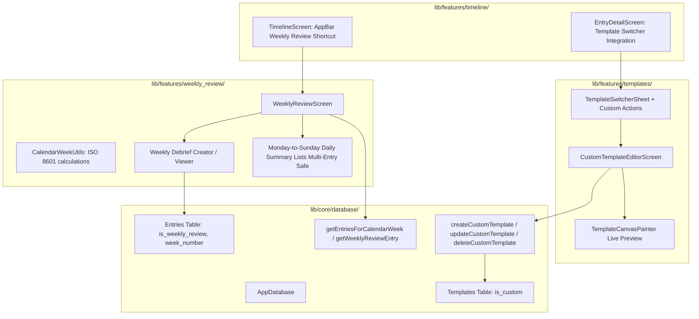

# Phase 5 Implementation Plan: User-Defined Custom Templates & Dedicated Weekly Review

## Overview & Architecture Alignment
Phase 5 kicks off **Milestone 2 (Beta)** of MemoDiary (拾光日记). It delivers two signature features adhering strictly to the **$0 FOSS**, **Local-First**, and **Decoupled Content & Presentation** invariants established in `GEMINI.md`:
1. **User-Defined Custom Templates**: Allowing users to create, preview, edit, and delete procedural diary canvas templates with custom colors, paper rules, grid sizes, margins, line spacing, and fonts—with strictly enforced system template protection and zero-loss entry reassignment upon template deletion.
2. **Dedicated Weekly Review Aggregated View**: A dedicated dashboard organizing Monday-to-Sunday diary entries side-by-side with mood badges, week navigation steppers, and a one-click weekly debrief drafting workflow linking directly to `is_weekly_review = 1` entries.

---

## 1. Technical Watchpoints & Safeguards

> [!IMPORTANT]
> **Watchpoint 1: Multiple Entries per Day in Weekly View**
> - **The Risk**: A user may write multiple separate entries on a single weekday (e.g., a morning reflection, afternoon notes, and an evening debrief). Assuming a 1-to-1 mapping between a calendar date and an entry causes data truncation or silent omissions.
> - **The Safeguard**: Group entries by calendar date (`DateTime(entryDate.year, entryDate.month, entryDate.day)`) into a `Map<DateTime, List<Entry>>`. The Monday–Sunday day cards in `WeeklyReviewScreen` will render a vertically stacked list of entry item cards for days with multiple entries, showing timestamps, titles, mood badges, and media previews for every single entry recorded on that day.

> [!IMPORTANT]
> **Watchpoint 2: ISO Week Boundary Timestamp Precision**
> - **The Risk**: Using naive date arithmetic like `DateTime(year, 1, 1).add(Duration(days: weekNumber * 7))` fails at year boundaries (e.g., late December dates belonging to Week 1 of the next year, or early January dates belonging to Week 52/53 of the prior year).
> - **The Safeguard**:
>   - In `CalendarWeekUtils.getIsoWeekRange()`, identify the target week's Monday using the official ISO Thursday rule (find Jan 4 of the ISO year, determine first Monday, offset by `(weekNumber - 1) * 7` days).
>   - Define `startOfWeek = DateTime(monday.year, monday.month, monday.day, 0, 0, 0, 0)` and `endOfWeek = DateTime(sunday.year, sunday.month, sunday.day, 23, 59, 59, 999)`.
>   - In SQLite queries, compare timestamps using `entryDate.isBiggerOrEqualValue(startOfWeek) & entryDate.isSmallerOrEqualValue(endOfWeek)`.

> [!IMPORTANT]
> **Watchpoint 3: Foreign Key Deletion Order**
> - **The Risk**: Because `entries.template_id` references `templates.id` with foreign key constraints, attempting to delete a template while entries point to it causes SQLite to throw `SqliteException (code 787: FOREIGN KEY constraint failed)`.
> - **The Safeguard**: Inside `deleteCustomTemplate`, execute strictly in sequence within an atomic `transaction`:
>   1. `await (update(entries)..where((t) => t.templateId.equals(templateId))).write(EntriesCompanion(templateId: Value(fallbackTemplateId), updatedAt: Value(DateTime.now())));`
>   2. `await (delete(templates)..where((t) => t.id.equals(templateId))).go();`
>   This guarantees zero dangling foreign keys and ensures entries seamlessly fall back to `template_minimalist_white` without data or presentation loss.

---

## 2. Architecture & Proposed Changes

---

## 3. File-by-File Detailed Specification

### A. Database Layer (`lib/core/database/app_database.dart`)
1. **Custom Template Insert**:
   - `createCustomTemplate`: Generates UUID-based template ID (`template_custom_${uuid}`), strictly assigns `isCustom: true`, and inserts into `templates`.
2. **Custom Template Update**:
   - `updateCustomTemplate`: Updates name, background type, background value, font family, line spacing, and horizontal margin. Enforces `isCustom == true`; throws `StateError` if attempting to modify a system preset template.
3. **Custom Template Safe Deletion & Entry Reassignment (Guard 3)**:
   - `deleteCustomTemplate(String templateId, {String fallbackTemplateId = 'template_minimalist_white'})`:
     - Verifies `isCustom == true` (system templates like `template_minimalist_white` cannot be deleted).
     - Executes an atomic `transaction`:
       - First, reassigns all entries referencing `templateId` to `fallbackTemplateId` (`reassignEntriesTemplate`).
       - Then, executes `delete(templates)..where((t) => t.id.equals(templateId))`.
4. **Weekly Review Queries (Guard 2)**:
   - `getEntriesForCalendarWeek(int year, int weekNumber)`:
     - Calculates ISO 8601 week bounds `[startOfWeek, endOfWeek]` with millisecond boundary precision (`00:00:00.000` to `23:59:59.999`).
     - Queries non-deleted entries (`isDeleted = false`) where `entryDate >= start` and `entryDate <= end`, sorted chronologically (`entryDate ASC`).
   - `getWeeklyReviewEntry(int year, int weekNumber)`:
     - Queries non-deleted entries where `isWeeklyReview = true` and `weekNumber = weekNumber` (and entryDate matches the ISO week year).

### B. Custom Template Builder (`lib/features/templates/screens/custom_template_editor_screen.dart`)
1. **Interactive Controls**:
   - **Template Name Input**: TextFormField with validation (non-empty, trimmed, max 30 chars).
   - **Background Type Selector**: SegmentedButton choosing among `color` (Solid Color), `lined` (Ruled Paper), `grid` (Graph Paper), and `paper_texture` (Kraft Paper).
   - **Background Color Picker**:
     - Palette of curated diary hues (White `#FFFFFF`, Ivory `#FAF8F5`, Soft Cream `#FDF6E2`, Kraft Warm `#EFE6D5`, Mint Whisper `#E8F5E9`, Sky Mist `#E3F2FD`, Rose Blush `#FCE4EC`, Lavender `#F3E5F5`, Dark Slate `#1E1E1E`).
     - Hex code text field with instant color preview and regex validation.
   - **Line Spacing Slider**: Range `1.0` to `2.5` with step `0.1` and live value label.
   - **Horizontal Margin Slider**: Range `12.0` to `48.0` with step `2.0` and live value label.
   - **Font Family Selector**: Dropdown or chips drawing from `TypographyCatalog.options` (e.g. System, Serif, Noto Serif, Caveat handwritten, Ma Shan Zheng calligraphy, etc.).
2. **Live Interactive Preview**:
   - Prominent preview viewport wrapping `TemplateCanvasContainer` with live `TemplateStyle`.
   - Displays sample journal header, title, and rich multiline text dynamically reflecting selected color, margins, ruled lines/grids, and typography in real time.
3. **Save & Validate Action**:
   - Validates form fields, calls `createCustomTemplate` (or `updateCustomTemplate`), and pops with the resulting `Template`.

### C. Weekly Review Feature (`lib/features/weekly_review/`)
1. **ISO 8601 Week Utilities (`lib/features/weekly_review/services/calendar_week_utils.dart`) (Guard 2)**:
   - `getIsoWeekNumber(DateTime date)`: Computes ISO calendar week (1–53) based on Thursday rule.
   - `getIsoWeekYear(DateTime date)`: Computes ISO calendar week year.
   - `getIsoWeekRange(int year, int weekNumber)`: Returns exact Monday 00:00:00.000 to Sunday 23:59:59.999 boundary.
   - `getAdjacentWeek(int year, int weekNumber, int delta)`: Smoothly transitions across year boundaries (handling 52- and 53-week years).
   - `formatWeekRange(int year, int weekNumber)`: Generates localized human-readable range (e.g., `Oct 12 – Oct 18, 2026`).
2. **Weekly Review Dashboard (`lib/features/weekly_review/screens/weekly_review_screen.dart`) (Guard 1)**:
   - **Week Stepper Header**: Previous Week (`<`), Week Title (`Week 42, 2026 · Oct 12 – Oct 18`), Next Week (`>`), and "Current Week" quick action.
   - **Weekly Summary Metric Strip**: Total entries count, mood summary pill badges, and weekly debrief status indicator.
   - **Monday-to-Sunday Daily Summary Cards (Multi-Entry Support)**:
     - 7 day slots (Monday through Sunday).
     - Entries grouped into `Map<DateTime, List<Entry>>` by calendar day.
     - Days with 1 or more entries: Renders a vertical stack of entry cards for all entries logged on that day, showing time, title, preview snippet, mood emoji, weather icon, and media indicator. Tapping navigates to `EntryDetailScreen`.
     - Days without entries: Clean dashed outline card with prompt "No entry recorded" and a "+" quick-add button for that specific date.
   - **Weekly Debrief Section**:
     - If debrief exists: Card showing `W{weekNumber} Review` badge, title, excerpt, and "Open Debrief" button.
     - If debrief pending: Call-to-action banner "Draft Weekly Debrief" with "Start Review" button, pre-populating an entry with `isWeeklyReview = true`, `weekNumber = weekNumber`, `templateId = 'template_weekly_review'`, and opening `EntryEditorScreen`.

### D. Navigation & UI Integration Updates
1. **`TemplateSwitcherSheet` (`lib/features/templates/widgets/template_switcher_sheet.dart`)**:
   - Accepts `AppDatabase database`.
   - Adds "+ New Template" action card in the template list.
   - Adds edit and delete actions on custom templates (with deletion confirmation dialog and automatic fallback reassignment).
2. **`TimelineScreen` (`lib/features/timeline/screens/timeline_screen.dart`)**:
   - Adds AppBar shortcut button `IconButton(icon: Icon(Icons.calendar_view_week_rounded), tooltip: 'Weekly Review')` launching `WeeklyReviewScreen`.
3. **`EntryDetailScreen` & `EntryEditorScreen`**:
   - Updated to pass `widget.database` to `TemplateSwitcherSheet.show` so custom template creation and deletion are directly accessible while reading or writing entries.

---

## 4. Step-by-Step Task Checklist

- [ ] **Step 1: Database Support for Custom Templates & Calendar Week Queries**
  - [ ] Add `createCustomTemplate`, `updateCustomTemplate`, `deleteCustomTemplate`, and `reassignEntriesTemplate` to `AppDatabase` in `lib/core/database/app_database.dart` with atomic reassignment order.
  - [ ] Add `getEntriesForCalendarWeek` (using `startOfWeek` and `endOfWeek` range) and `getWeeklyReviewEntry` to `AppDatabase`.
  - [ ] Write unit tests in `test/core/database/custom_templates_test.dart` verifying custom template CRUD, system template protection, and foreign key deletion order.

- [ ] **Step 2: ISO 8601 Calendar Week Engine & Utilities**
  - [ ] Implement `CalendarWeekUtils` in `lib/features/weekly_review/services/calendar_week_utils.dart` with official ISO Thursday rule.
  - [ ] Write unit tests in `test/features/weekly_review/calendar_week_utils_test.dart` verifying week calculations across leap years, 52/53-week transitions, and year boundaries.

- [ ] **Step 3: Custom Template Builder Screen**
  - [ ] Implement `CustomTemplateEditorScreen` in `lib/features/templates/screens/custom_template_editor_screen.dart`.
  - [ ] Integrate real-time procedural canvas preview with `TemplateCanvasContainer`.
  - [ ] Write widget tests in `test/features/templates/custom_template_editor_screen_test.dart`.

- [ ] **Step 4: Template Switcher Sheet Custom Template Management**
  - [ ] Update `TemplateSwitcherSheet` to support creating custom templates, editing existing custom templates, and deleting custom templates with safety confirmations.
  - [ ] Update `test/features/templates/template_switcher_test.dart` with custom template management test cases.

- [ ] **Step 5: Dedicated Weekly Review Aggregation & Dashboard Screen**
  - [ ] Implement `WeeklyReviewScreen` in `lib/features/weekly_review/screens/weekly_review_screen.dart` with multi-entry per day support.
  - [ ] Implement Monday-to-Sunday 7-day card layout and empty-day quick-add.
  - [ ] Implement weekly debrief creator workflow (`isWeeklyReview = true`).
  - [ ] Write widget tests in `test/features/weekly_review/weekly_review_screen_test.dart` verifying multi-entry display and week stepping.

- [ ] **Step 6: Navigation & Screen Linking**
  - [ ] Add Weekly Review action icon in `TimelineScreen` AppBar.
  - [ ] Connect `TemplateSwitcherSheet` across `EntryDetailScreen` and `EntryEditorScreen`.
  - [ ] Write integration widget test verifying navigation between Timeline, Weekly Review, and Template Builder.

---

## 5. Verification Plan

### Automated Unit & Widget Tests
1. **Database & Foreign Key Invariants**:
   - `test/core/database/custom_templates_test.dart`:
     - Creating custom template sets `isCustom = true`.
     - Attempting to delete `template_minimalist_white` throws `StateError`.
     - Deleting custom template reassigns associated entries to `template_minimalist_white` without foreign key constraint violations.
     - Content Delta and plainText of entries remain 100% untouched after template deletion and reassignment.
2. **Weekly Review Calendar Logic & Precision**:
   - `test/features/weekly_review/calendar_week_utils_test.dart`:
     - Test dates in 2025/2026/2027 year boundaries (e.g. Dec 29, 2025 -> Week 1 2026; Jan 1, 2026 -> Week 1 2026).
     - Test timestamp precision: Monday 00:00:00.000 to Sunday 23:59:59.999.
     - Test stepping across 52- and 53-week years.
   - `test/features/weekly_review/weekly_review_db_test.dart`:
     - `getEntriesForCalendarWeek` fetches all entries within the target week window and excludes entries outside the window.
     - Multiple entries logged on the same date are all retrieved in chronological order.
     - Soft-deleted entries are excluded.
3. **UI & Multi-Entry Widget Tests**:
   - `test/features/templates/custom_template_editor_screen_test.dart`:
     - Modifying sliders and background type repaints live preview.
     - Form validation rejects empty name.
     - Save button writes to database and returns newly created `Template`.
   - `test/features/weekly_review/weekly_review_screen_test.dart`:
     - Verifies day cards with 2+ entries render all entries stacked without clipping or dropping records.
     - Previous/next buttons step weeks and reload entries.
     - Clicking "Start Review" launches editor with `isWeeklyReview = true` and target week number.
   - `test/features/timeline/timeline_screen_test.dart`:
     - AppBar contains Weekly Review button and navigates to `WeeklyReviewScreen`.
