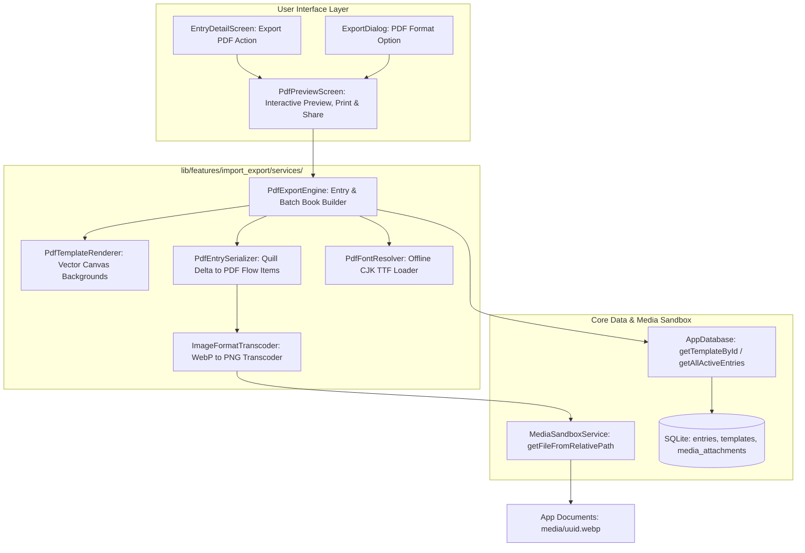

# Phase 6 Implementation Plan: Template-Preserving High-Fidelity PDF Export Engine

## Overview & Architecture Alignment
Phase 6 brings **Template-Preserving High-Fidelity PDF Export** to MemoDiary (拾光日记), fulfilling Milestone 2 (Beta) requirements while strictly adhering to `GEMINI.md` invariants:
- **$0 Build & Runtime Cost**: Uses 100% free, open-source libraries (`pdf: ^3.11.1` and `printing: ^5.13.2`, Apache 2.0 licensed) and built-in native rendering. Zero cloud APIs, zero third-party subscriptions.
- **Local-First & Offline Network Quarantine**: PDF generation occurs entirely on-device with zero network transmissions. An automated network quarantine test ensures no remote connections are attempted during export.
- **Decoupled Content & Presentation**: Content semantics (`flutter_quill` Delta JSON) and visual templates (`TemplateStyle` from the `templates` SQLite table) are faithfully composed into vector PDF pages preserving ruled lines, graph paper grids, kraft textures, margins, and typography.
- **Sandboxed Media Isolation**: Resolves embedded images strictly from relative paths (e.g., `media/{uuid}.webp`) via `MediaSandboxService.getFileFromRelativePath()`.

---

## 1. Critical Execution Watchpoints & Safeguards

> [!IMPORTANT]
> **Watchpoint 1: CJK / Chinese Character Trap in PDF Standard Fonts**
> - **The Risk**: Standard PostScript PDF fonts (`pw.Font.helvetica()`, `pw.Font.times()`, `pw.Font.courier()`) only support Western Latin-1 encoding (WinAnsiEncoding) and contain zero CJK glyphs. If Chinese characters (e.g. "拾光日记", "今天天气晴朗") are rendered with `helvetica()`, the `pdf` package throws `Exception: Font Helvetica has no character ... (U+...)` or renders empty question marks.
> - **The Safeguard**:
>   - `PdfExportEngine` will support loading offline TrueType Font (`.ttf`) data via `pw.Font.ttf(byteData)` for CJK text rendering.
>   - Provide a modular `PdfFontResolver` supporting offline bundled TTF font loading with zero network calls.
>   - Implement safe glyph fallback/sanitization to guarantee that even if standard Latin fonts are used in headless fallback environments, non-Latin characters are handled safely without unhandled runtime crashes.

> [!IMPORTANT]
> **Watchpoint 2: WebP Image Format Compatibility in `package:pdf`**
> - **The Risk**: The Dart `pdf` package only parses raw JPEG (`0xFFD8`) and PNG (`0x89504E47`) into `pw.MemoryImage`. It does NOT parse WebP container formats (`RIFF...WEBP`). Because `MediaSandboxService` compresses and stores images as `.webp`, passing raw WebP bytes directly to `pw.MemoryImage` throws `Exception: Unknown image file format`.
> - **The Safeguard**:
>   - Implement an in-memory image transcoder `ImageFormatTranscoder.ensurePdfCompatibleImageBytes(Uint8List rawBytes)`.
>   - The transcoder inspects the initial magic bytes:
>     - If already PNG (`0x89504E47`) or JPEG (`0xFFD8`), passes through directly without CPU overhead.
>     - If WebP (`RIFF...WEBP`), transcodes to PNG in-memory using Flutter's native `dart:ui` image codec pipeline (`ui.instantiateImageCodec(rawBytes)` $\rightarrow$ `frame.image.toByteData(format: ui.ImageByteFormat.png)`).
>     - Resolves the transcoded bytes cleanly into `pw.MemoryImage`.

> [!IMPORTANT]
> **Watchpoint 3: Headless Unit Testing for `package:printing`**
> - **The Risk**: `PdfPreview` uses native platform channels (`MethodChannel('net.nfet.printing')`) to rasterize preview pages. In headless widget tests (`flutter test`), this throws `MissingPluginException: No implementation found for method raster on channel net.nfet.printing`.
> - **The Safeguard**:
>   - Focus primary automated unit and integration tests on verifying byte generation via `PdfExportEngine.generatePdfForEntry()` and `generateConsolidatedPdf()` (asserting non-empty buffer, `%PDF-1.` header signature, and correct page structure).
>   - In widget tests for `PdfPreviewScreen` and `ExportDialog`, mock the `net.nfet.printing` platform channel via `TestDefaultBinaryMessengerBinding.instance.defaultBinaryMessenger.setMockMethodCallHandler` to return mock raster frames, ensuring headless widget tests execute cleanly without throwing.

---

## 2. Architecture & Data Flow

---

## 3. Proposed Changes

### A. Dependencies & Configuration (`pubspec.yaml`)
#### [MODIFY] `pubspec.yaml`
- Add `pdf: ^3.11.1` under `dependencies` (100% open-source vector PDF generation).
- Add `printing: ^5.13.2` under `dependencies` (platform-agnostic PDF preview, printing, and file export).

---

### B. Procedural PDF Template Canvas Renderer (`lib/features/import_export/services/pdf_template_renderer.dart`)
#### [NEW] `pdf_template_renderer.dart`
- `PdfTemplateRenderer`:
  - `buildBackground(pw.Context context, TemplateStyle style)`:
    - Renders a full-bleed `pw.FullPage(ignoreMargins: true)` container.
    - Solid background fill using `PdfColor.fromInt(style.backgroundColor.toARGB32())`.
    - Procedural drawing matching `TemplateBackgroundType`:
      1. **Minimalist White (`color`)**: Clean solid background with subtle header/footer margins.
      2. **Lined Paper (`lined`)**: Horizontal ruled lines with spacing derived from `style.lineSpacing` (`rowHeight = 24.0 * (style.lineSpacing / 1.5)`), plus vertical notebook red margin guide (`x = style.marginHorizontal`).
      3. **Grid Paper (`grid`)**: Orthogonal millimeter vector grid lines (`gridSize = 20.0 * (style.lineSpacing / 1.5)`).
      4. **Retro Kraft (`paper_texture`)**: Warm kraft fill (`#EFE6D5`) with vintage brown header and footer accent rules (`0x184E342E`).
      5. **Custom Templates**: Dynamically incorporates custom background colors, lines, grids, or margins.
  - `buildHeader(pw.Context context, Entry entry, TemplateStyle style, {pw.Font? font})`:
    - Running header with formatted entry date, title, and "MemoDiary" brandmark.
  - `buildFooter(pw.Context context, Entry entry, TemplateStyle style, {pw.Font? font})`:
    - Running footer with "Page ${context.pageNumber} of ${context.pagesCount}" and "100% Private · Local-First".

---

### C. Multi-Page Quill Delta to PDF Serializer & WebP Transcoder (`lib/features/import_export/services/`)
#### [NEW] `image_format_transcoder.dart`
- `ImageFormatTranscoder`:
  - `ensurePdfCompatibleImageBytes(Uint8List rawBytes)`:
    - Inspects magic bytes: returns as-is if PNG or JPEG.
    - If WebP: converts to PNG in-memory via `ui.instantiateImageCodec(rawBytes)` $\rightarrow$ `frame.image.toByteData(format: ui.ImageByteFormat.png)`.
#### [NEW] `pdf_entry_serializer.dart`
- `PdfEntrySerializer`:
  - `convertDeltaToWidgets(...)`:
    - Parses `contentDelta` JSON into structural line blocks:
      - **Headers**: `H1` (22pt bold), `H2` (18pt bold), `H3` (15pt bold) with proportional margins.
      - **Paragraphs & Rich Spans**: Inline bold, italic, underline, strikethrough, and custom text colors into `pw.RichText(text: pw.TextSpan(children: [...]))`.
      - **Blockquotes**: Left-accented box (`pw.Border(left: pw.BorderSide(color: PdfColors.grey600, width: 3.5))`) with italicized text.
      - **Lists**: Bullet lists (`pw.Row([pw.Text('• '), pw.Expanded(child: ...)])`) and numbered lists (`pw.Row([pw.Text('$i. '), pw.Expanded(child: ...)])`).
      - **Dividers**: Horizontal rule `pw.Divider(thickness: 0.8, color: PdfColors.grey300)`.
      - **Embedded Images (Watchpoint 2)**:
        - Detects `{'insert': {'image': 'media/xxx.webp'}}`.
        - Resolves image file using `MediaSandboxService.getFileFromRelativePath(path)`.
        - Transcodes WebP bytes to PNG via `ImageFormatTranscoder`.
        - Decodes bytes into `pw.MemoryImage` with bounded `maxHeight: 260.0`, rounded corners, and centered alignment.
        - Graceful placeholder fallback if image file is not found on disk.
    - Fallback: If `contentDelta` is empty or invalid, serializes `entry.plainText` gracefully into paragraphs.

---

### D. High-Fidelity PDF Export Engine & Font Resolver (`lib/features/import_export/services/`)
#### [NEW] `pdf_font_resolver.dart`
- `PdfFontResolver`:
  - Manages offline font data with zero network transmissions.
  - Supports loading CJK TrueType Fonts via `pw.Font.ttf(byteData)` (Watchpoint 1).
  - Provides safe character sanitization when standard PostScript fonts are used as fallback.
#### [NEW] `pdf_export_engine.dart`
- `PdfExportEngine`:
  - `generatePdfForEntry({required Entry entry, required AppDatabase database, required MediaSandboxService mediaService, PdfPageFormat pageFormat = PdfPageFormat.a4, pw.Font? cjkFont})`:
    - Loads active template from `database.getTemplateById(entry.templateId)`.
    - Converts Delta to PDF flow widgets via `PdfEntrySerializer`.
    - Generates entry metadata header: formatted date, mood rating badge, weather icon tag, title.
    - Constructs `pw.Document` with `pw.MultiPage`, attaching `PdfTemplateRenderer.buildBackground`, header, and footer.
    - Emits byte array `Uint8List`.
  - `generateConsolidatedPdf({required List<Entry> entries, required AppDatabase database, required MediaSandboxService mediaService, PdfPageFormat pageFormat = PdfPageFormat.a4, String? bookTitle, pw.Font? cjkFont})`:
    - Generates a multi-entry consolidated PDF document (Journal Book).
    - Includes an archive cover page with book title, date range, entry count, and privacy notice.
    - Sequentially appends each entry as its own `pw.MultiPage` section with its respective template background.

---

### E. Export UI & Print Preview Screens (`lib/features/import_export/widgets/`)
#### [NEW] `pdf_preview_screen.dart`
- `PdfPreviewScreen`:
  - Full-screen interactive viewer using `PdfPreview` from `package:printing`.
  - Supports live pinch-to-zoom, page thumbnail navigation, A4 / Letter format toggling, direct system printing, native PDF sharing, and saving to disk.
#### [MODIFY] `export_dialog.dart`
- Add `pdf` to `ExportFormat` enum.
- Add third choice: `PDF Document (.pdf)` ("Template-preserving high-fidelity vector PDF").
- Selecting PDF and confirming launches `PdfPreviewScreen` with the selected entry or batch of entries.
#### [MODIFY] `lib/features/timeline/screens/entry_detail_screen.dart`
- Add "Export PDF" icon button (`Icons.picture_as_pdf_outlined`) in `AppBar.actions` and bottom action bar, directly opening `PdfPreviewScreen`.

---

## 4. Step-by-Step Task Checklist

- [ ] **Step 1: Dependencies & Foundation**
  - [ ] Add `pdf: ^3.11.1` and `printing: ^5.13.2` to `pubspec.yaml`.
  - [ ] Run `flutter pub get` and verify dependency resolution.

- [ ] **Step 2: WebP In-Memory Transcoder & Offline Font Resolver**
  - [ ] Implement `ImageFormatTranscoder` in `lib/features/import_export/services/image_format_transcoder.dart` converting WebP to PNG in-memory.
  - [ ] Implement `PdfFontResolver` in `lib/features/import_export/services/pdf_font_resolver.dart` with offline CJK font support and Latin-1 fallback safety.
  - [ ] Write unit tests in `test/features/import_export/image_format_transcoder_test.dart` and `test/features/import_export/pdf_font_resolver_test.dart`.

- [ ] **Step 3: Procedural PDF Template Canvas Renderer**
  - [ ] Implement `PdfTemplateRenderer` in `lib/features/import_export/services/pdf_template_renderer.dart`.
  - [ ] Support Minimalist White, Lined Paper, Grid Paper, Retro Kraft, and custom template styles in PDF coordinate space.
  - [ ] Write unit tests in `test/features/import_export/pdf_template_renderer_test.dart`.

- [ ] **Step 4: Multi-Page Quill Delta to PDF Serializer**
  - [ ] Implement `PdfEntrySerializer` in `lib/features/import_export/services/pdf_entry_serializer.dart`.
  - [ ] Implement headers, styled spans, blockquotes, lists, dividers, and sandboxed WebP image resolution via transcoder.
  - [ ] Write unit tests in `test/features/import_export/pdf_entry_serializer_test.dart`.

- [ ] **Step 5: PDF Export Engine & Batch Consolidated Book Generator**
  - [ ] Implement `PdfExportEngine` in `lib/features/import_export/services/pdf_export_engine.dart`.
  - [ ] Implement single entry export and multi-entry consolidated book export with cover page.
  - [ ] Write integration tests in `test/features/import_export/pdf_export_engine_test.dart`.

- [ ] **Step 6: Network Quarantine Test Suite**
  - [ ] Implement `test/features/import_export/pdf_network_quarantine_test.dart` using custom `HttpOverrides` asserting zero network calls during PDF generation.

- [ ] **Step 7: UI Integration & Print Preview Screen (Headless Mock-Safe)**
  - [ ] Implement `PdfPreviewScreen` in `lib/features/import_export/widgets/pdf_preview_screen.dart`.
  - [ ] Update `ExportDialog` with PDF format option.
  - [ ] Update `EntryDetailScreen` with direct PDF export action.
  - [ ] Write widget tests in `test/features/import_export/pdf_preview_screen_test.dart` using mock method channels for `net.nfet.printing`.

- [ ] **Step 8: Verification & Final Regression**
  - [ ] Run `analyze_files` across the entire project.
  - [ ] Run complete `flutter test` suite.

---

## 5. Verification Plan

### Automated Unit & Integration Tests
1. **WebP Transcoder & Font Tests (`test/features/import_export/image_format_transcoder_test.dart` & `pdf_font_resolver_test.dart`)**:
   - Asserts PNG/JPEG pass through without transcoding.
   - Asserts WebP converts to valid PNG bytes.
   - Asserts CJK font loader and Latin-1 fallback safely handle characters without throwing.
2. **Quill Delta to PDF Conversion Tests (`test/features/import_export/pdf_entry_serializer_test.dart`)**:
   - Converts H1, H2, H3 headers, bold/italic/underline text, blockquotes, bullet and ordered lists.
   - Resolves sandboxed images and clamps height to 260pt.
   - Converts empty or malformed Delta without throwing exceptions.
3. **Template Background & Byte Integrity Tests (`test/features/import_export/pdf_template_renderer_test.dart`)**:
   - Generates PDFs across all 4 built-in templates (`Minimalist White`, `Lined Paper`, `Grid Paper`, `Retro Kraft`) and custom templates.
   - Asserts non-empty byte buffer starting with PDF header signature (`%PDF-1.`).
4. **Network Quarantine Verification (`test/features/import_export/pdf_network_quarantine_test.dart`)**:
   - Intercepts all socket/HTTP traffic with `HttpOverrides.global`.
   - Asserts zero outbound requests are made during single-entry and consolidated multi-entry PDF exports.
5. **Interactive UI & Export Tests (`test/features/import_export/pdf_preview_screen_test.dart`)**:
   - Mocks `net.nfet.printing` method channel.
   - `PdfPreviewScreen` renders preview without `MissingPluginException`.
   - `ExportDialog` includes PDF format option and opens preview screen.
   - `EntryDetailScreen` PDF export icon triggers preview navigation.
