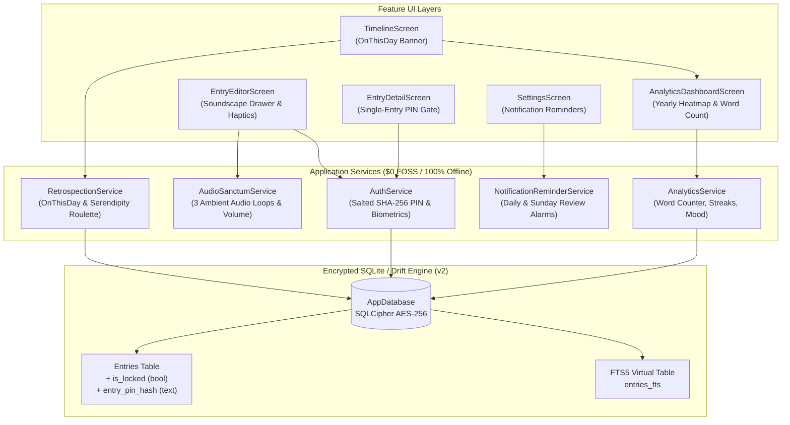

# Phase 8 Implementation Plan: Retrospective Suite, Writing Sanctum, Local Reminders & Analytics

This plan defines the architecture, database schema enhancements, service layers, UI components, and automated verification suite for **Phase 8 (Final Milestone 2 Beta Phase)** in MemoDiary (拾光日记).

All implementations strictly adhere to the invariants in [GEMINI.md](file:///home/harry1029/projects/memodiary/GEMINI.md): **$0 FOSS**, **Zero-Cloud / Offline-First**, **Local Sandboxed Isolation**, and **Decoupled Presentation**.

---

## 1. Architecture & Component Blueprint



---

## 2. Technical Watchpoints & Safeguards During Execution

> [!WARNING]
> ### Watchpoint 1: Android 13+ Notification Permission & Timezone Initialization
> - **The Risk**: On Android 13+ (API 33+), local push notifications fail silently if `android.permission.POST_NOTIFICATIONS` is not declared. Furthermore, `package:timezone` throws `TimezoneInitializationException` when calling `tz.TZDateTime` if `tz.initializeTimeZones()` is not invoked prior to scheduling notifications.
> - **The Safeguard**:
>   1. Add `<uses-permission android:name="android.permission.POST_NOTIFICATIONS"/>` to `android/app/src/main/AndroidManifest.xml` (while strictly keeping `android.permission.INTERNET` absent).
>   2. Call `tz.initializeTimeZones()` inside `NotificationReminderService.init()` and ensure tests register timezone database data.

> [!IMPORTANT]
> ### Watchpoint 2: WAV Loop Buffer Duration & Seam Crossfade
> - **The Risk**: If procedurally synthesized WAV loops are too short (<1s), continuous cycling causes high CPU overhead, and amplitude discontinuities between the final sample and initial sample produce audible popping/clicking artifacts.
> - **The Safeguard**:
>   1. Synthesize audio buffers of at least **3 to 5 seconds** at a lightweight sample rate (22,050 Hz, 16-bit mono).
>   2. Apply a **50ms linear fade-in and fade-out** window at the start and end boundaries of the PCM byte buffer to guarantee a zero-crossing seam for smooth, click-free gapless looping in `ReleaseMode.loop`.

> [!CAUTION]
> ### Watchpoint 3: Drift Schema v2 In-Memory Testing Integrity
> - **The Risk**: Test setups calling `AppDatabase.forTesting(NativeDatabase.memory())` invoke `m.createAll()`, which automatically generates v2 columns directly from updated Dart table declarations. This verifies fresh database creation, but will not test `onUpgrade` unless migration is exercised against a simulated v1 database.
> - **The Safeguard**: In `test/core/database/single_entry_lock_test.dart`, explicitly construct a simulated v1 database schema (lacking `is_locked` and `entry_pin_hash`), run the `AppDatabase` migration strategy to v2, and assert that:
>   - Existing entries retain their content without data corruption.
>   - The new columns `is_locked` and `entry_pin_hash` are successfully appended and queryable.

---

## 3. Proposed Changes

### A. Dependencies & Manifest (`pubspec.yaml` & `AndroidManifest.xml`)
#### [MODIFY] `pubspec.yaml`
- Add `audioplayers: ^6.1.0` (MIT, local gapless audio player).
- Add `flutter_local_notifications: ^18.0.1` (BSD-3-Clause, 100% offline local push notifications).
- Add `timezone: ^0.10.1` (for zoned local schedule calculations).

#### [MODIFY] `android/app/src/main/AndroidManifest.xml`
- Add `<uses-permission android:name="android.permission.POST_NOTIFICATIONS"/>` (Watchpoint 1).

---

### B. Single-Entry Password Lock (Database & Auth Layers)
#### [MODIFY] `lib/core/database/tables/entries.dart`
- Add columns:
  ```dart
  /// Whether this specific entry is locked behind a PIN / biometric challenge
  BoolColumn get isLocked => boolean().withDefault(const Constant(false))();

  /// Salted SHA-256 PIN hash (format: "salt:hash") or null if protected by master app PIN
  TextColumn get entryPinHash => text().nullable()();
  ```

#### [MODIFY] `lib/core/database/app_database.dart`
- Bump `schemaVersion` to `2`.
- Update `MigrationStrategy` with:
  ```dart
  onUpgrade: (Migrator m, int from, int to) async {
    if (from < 2) {
      await m.addColumn(entries, entries.isLocked);
      await m.addColumn(entries, entries.entryPinHash);
    }
  },
  ```
- Add mutation methods:
  - `lockEntry(String entryId, {String? pinHash})`
  - `unlockEntryPermanently(String entryId)`
  - Update `updateEntry` and `createEntry` to accept `isLocked` and `entryPinHash`.

#### [MODIFY] `lib/core/services/auth_service.dart`
- Expose cryptographic single-entry hashing helpers:
  - `static String hashEntryPin(String pin, {String? salt})`: produces `$salt:$hash` using SHA-256.
  - `static bool verifyEntryPin(String pin, String storedSaltAndHash)`: constant-time hash comparison.

#### [MODIFY] `lib/features/timeline/widgets/entry_summary_card.dart`
- When `entry.isLocked == true`:
  - Display `Icons.lock_rounded` icon badge.
  - Obscure body snippet with secure placeholder text: *"🔒 Locked Diary Entry"*.
  - Suppress media thumbnails from rendering on the card feed.

#### [MODIFY] `lib/features/timeline/screens/entry_detail_screen.dart`
- If `_entry.isLocked == true`:
  - Show PIN entry barrier with biometric unlock option before revealing template canvas & Quill content.
  - Add lock management action in `AppBar` (Lock/Unlock toggle, change custom entry PIN).

---

### C. Retrospective Reflection Engine (`lib/features/retrospection/`)
#### [MODIFY] `lib/core/database/app_database.dart`
- Add `getEntriesOnThisDay(DateTime date)`:
  - Fetches non-deleted entries where `entryDate.year < date.year` and month/day match.
  - **Leap Year Edge Case Guard**: When `date` is Feb 28 in non-leap years, include historical Feb 29 leap entries; when `date` is Feb 29, include historical Feb 29 (and Feb 28) entries.
- Add `getRandomOldEntry({int minDaysAgo = 90})`:
  - Fetches a random active entry written $\ge 90$ days prior to `DateTime.now()`.

#### [NEW] `lib/features/retrospection/widgets/on_this_day_banner.dart`
- Celebratory banner at the top of `TimelineScreen` when historical entries exist for today.
- Highlights "N years ago today" with a memory preview button opening an interactive carousel dialog.

#### [NEW] `lib/features/retrospection/widgets/serendipity_roulette_card.dart`
- Interactive roulette card widget allowing users to tap "🎲 Draw Past Memory" to resurface forgotten thoughts written $\ge 90$ days ago.

---

### D. Writing Analytics & Heatmap Dashboard (`lib/features/analytics/`)
#### [NEW] `lib/features/analytics/services/analytics_service.dart`
- Computes comprehensive offline diary metrics:
  - `totalEntries`: count of all active entries.
  - `totalWords`: word count aggregator (supporting both whitespace-separated Latin words and Chinese CJK character counting).
  - `currentStreak` & `longestStreak`: consecutive days of journaling.
  - `journalingDaysTotal`: count of distinct calendar days with logged entries.
  - `moodDistribution`: Map of mood ratings 1–5 to frequency.
  - `dailyActivityMap`: `Map<DateTime, int>` tallying entries for every calendar day across the trailing 365 days (52 weeks).

#### [NEW] `lib/features/analytics/widgets/yearly_contribution_heatmap.dart`
- Pure Flutter `CustomPainter` rendering a 52-column × 7-row (Monday–Sunday) activity matrix.
- Color gradient levels (0 = empty, 1 = 1 entry, 2 = 2 entries, 3 = 3+ entries).
- Horizontal scroll with month indicators (Jan–Dec) and day indicators (Mon, Wed, Fri).

#### [NEW] `lib/features/analytics/screens/analytics_dashboard_screen.dart`
- Full metrics screen displaying:
  1. Key Metrics Row: Total Words, Active Days, Current Streak, Longest Streak.
  2. Yearly Heatmap Card with color scale legend.
  3. Mood Rating Spectrum Bar Chart with emojis (😢 🙁 😐 🙂 😄).
  4. Time of Day Distribution (Morning, Afternoon, Evening, Night).
- Accessible from `TimelineScreen` AppBar action and `SettingsScreen` list tile.

---

### E. Ambient Soundscapes ("Writing Sanctum") & Haptics
#### [NEW] `lib/features/editor/services/audio_sanctum_service.dart`
- Powered by `audioplayers: ^6.1.0`.
- Manages 3 soundscapes:
  - **Gentle Rain**: Calming rainfall loop.
  - **Vintage Library**: Subtle room ambiance with paper rustle and fireplace warmth.
  - **Mechanical Keyboard**: Crisp rhythmic typing clicks.
- Built-in procedural WAV generator (`ProceduralAudioSynthesizer`) generating **3–5 second loop buffers with a 50ms linear crossfade** at boundaries (Watchpoint 2) into temporary directory with 0 external network requests.
- Controls: `play(SoundscapeType)`, `pause()`, `resume()`, `stop()`, `setVolume(double)`, `dispose()`.

#### [NEW] `lib/features/editor/widgets/soundscape_modal.dart`
- Bottom sheet drawer in `EntryEditorScreen`:
  - Soundscape selector chips with icons.
  - Live Play/Pause toggle.
  - Volume slider (0% to 100%).

#### [MODIFY] `lib/features/editor/widgets/editor_toolbar.dart` & `entry_editor_screen.dart`
- Added soundscape headphones action button (`Icons.headphones_outlined`).
- Integrated `HapticFeedback.lightImpact()` on:
  - Template switching in `TemplateSwitcherSheet`.
  - Capsule locking in `EntryMetadataBar`.
  - Entry autosave and manual save actions.

---

### F. Scheduled Local Reminders (`lib/features/notifications/`)
#### [NEW] `lib/features/notifications/services/notification_reminder_service.dart`
- Powered by `flutter_local_notifications: ^18.0.1`.
- Calls `tz.initializeTimeZones()` upon initialization (Watchpoint 1).
- 100% offline local push notifications:
  - Daily Journaling Reminder (configurable time, e.g. 21:00).
  - Sunday Weekly Review Reminder (every Sunday, e.g. 20:00).
  - Immediate test notification trigger.
- Persists schedule preferences in secure storage / local state.

#### [NEW] `lib/features/settings/widgets/notification_settings_card.dart`
- Embedded into `SettingsScreen`:
  - Daily Reminder toggle switch + `showTimePicker` button.
  - Weekly Review Reminder toggle switch + `showTimePicker` button.
  - "Send Test Notification" button for instant physical verification.

---

## 4. Verification Plan

### Automated Tests
1. **Single-Entry Lock & Drift v1 $\rightarrow$ v2 Migration** (Watchpoint 3):
   - `test/core/database/single_entry_lock_test.dart`:
     - Test adding `isLocked` and `entryPinHash` to entries.
     - Test database upgrade from a simulated v1 database to v2 asserting zero data loss and queryability.
     - Test `lockEntry`, `unlockEntryPermanently`, and PIN hash verification.
2. **Retrospective Reflection Engine**:
   - `test/features/retrospection/on_this_day_test.dart`:
     - Test `getEntriesOnThisDay` across past years.
     - Test leap year edge case (Feb 29 on leap years vs Feb 28 on non-leap years).
     - Test `getRandomOldEntry` selecting entries $\ge 90$ days ago.
3. **Writing Analytics & Heatmap**:
   - `test/features/analytics/analytics_service_test.dart`:
     - Test word count aggregation for English and Chinese texts.
     - Test consecutive streak calculation and journaling day count.
     - Test mood distribution aggregation.
   - `test/features/analytics/yearly_heatmap_test.dart`:
     - Test `YearlyContributionHeatmap` widget and `CustomPainter` rendering.
4. **Writing Sanctum & Procedural Audio** (Watchpoint 2):
   - `test/features/editor/audio_sanctum_test.dart`:
     - Test procedural WAV synthesis (duration $\ge 3$s, 50ms boundary crossfade, sample rate 22,050 Hz, valid RIFF header).
     - Test `AudioSanctumService` volume adjustments, soundscape switching, and disposal.
5. **Scheduled Local Reminders** (Watchpoint 1):
   - `test/features/notifications/notification_reminder_test.dart`:
     - Verify `tz.initializeTimeZones()` executes cleanly without exceptions.
     - Mock method channels for `dexterous.com/flutter/local_notifications`.
     - Verify daily and weekly recurring reminder registration.
6. **Full Regression Suite**:
   - `analyze_files` across all project files (0 errors, 0 warnings).
   - Complete `flutter test` suite ensuring all 146+ tests pass.

### Manual Verification
1. **On This Day & Roulette**: Open timeline feed, verify banner appears when past-year entries match current date; trigger memory roulette and verify random $\ge 90$-day memory display.
2. **Single-Entry Lock**: Lock an entry from editor/detail, verify obscured card in timeline, and verify PIN/biometric unlock gate on detail view.
3. **Writing Sanctum**: Open editor, open soundscape drawer, choose Gentle Rain, adjust volume, verify ambient audio playback and haptics on template swap.
4. **Analytics Heatmap**: Open Analytics Dashboard from timeline or settings, verify 52-week contribution grid, streak tally, and word count.
5. **Scheduled Reminders**: Open Settings, toggle daily reminder, set time, tap test notification and verify local banner appears without network access.
